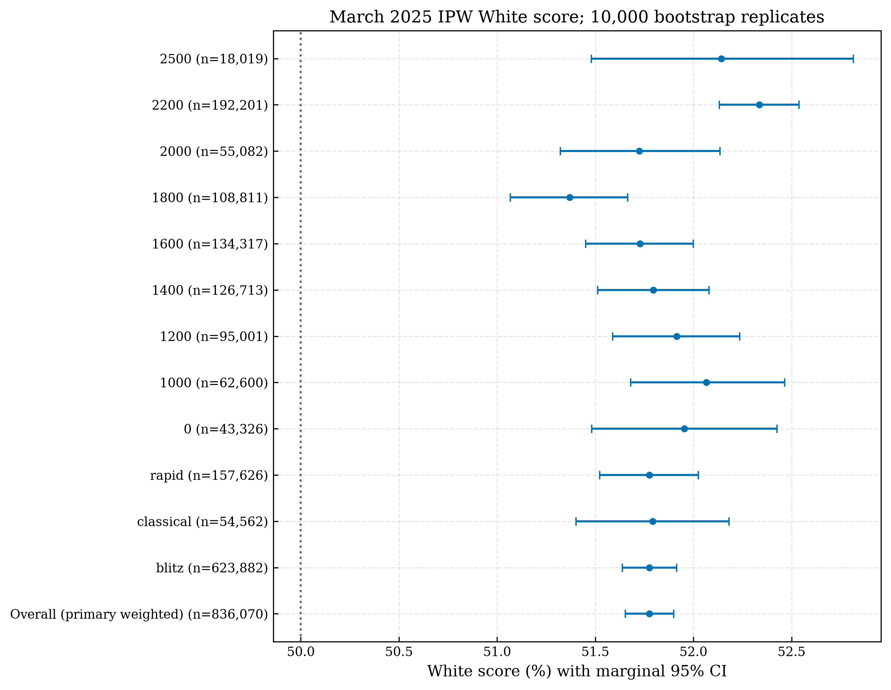
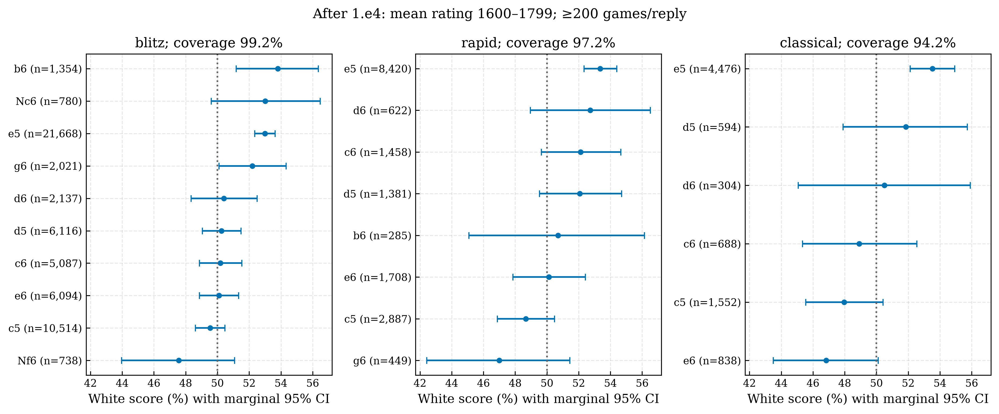
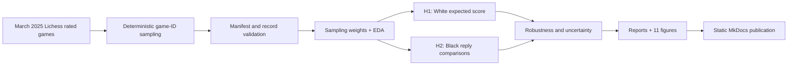

<div align="center">


<br />

[](https://blevis.github.io/White_Lies-Is_the_First-Move_Advantage_Real/)
[](reports/FINAL_RESEARCH_REPORT.md)
[](docs/reproducibility/installation.md)

**Chess × Data × Probability**

*An evidence-driven investigation of whether playing White confers a measurable advantage — and how Black's first reply relates to the outcome.*

[**🌐 Interactive publication**](https://blevis.github.io/White_Lies-Is_the_First-Move_Advantage_Real/) ·
[**📊 Explore findings**](docs/index.md) ·
[**📖 Methodology**](docs/methodology/statistics.md) ·
[**🔬 Reproducibility**](docs/reproducibility/installation.md)

</div>

---

## At a glance

| ♟️ Games sampled | ♔ Weighted White score | ↗ Advantage over 50% | 🎯 H2 score-spread signals |
| :---: | :---: | :---: | :---: |
| **836,070** | **51.776%** | **+1.776 pp** | **14 / 35 cells** |
| March 2025 · Lichess | 95% CI: 51.653–51.899% | Weighted eligible population | BH-adjusted; observational |

> **The headline:** White's expected score is statistically above 50% in this March 2025 Lichess sample. This is an *observational finding*, not proof that moving first causes the difference. Black-reply associations exist in some strata but are less robust when player ratings are closely matched.

**[→ Open the live White Lies website](https://blevis.github.io/White_Lies-Is_the_First-Move_Advantage_Real/)** to browse the research narrative, aggregate explorer, figures, methods and audit.

## The research questions

| Hypothesis | What we tested | Headline finding |
| --- | --- | --- |
| **H1 · First-move advantage** | Is White's weighted expected score greater than 50%, overall and across speed/rating groups? | **51.776%** overall; one-sided Monte Carlo **p = 9.999 × 10⁻⁵** (10,000-simulation resolution limit). |
| **H2 · Black's immediate reply** | After **1.e4** or **1.d4**, do reply choices differ in White/Draw/Black outcomes and White-score spread within speed/rating strata? | **14/35** eligible cells show adjusted score-spread differences; **15/35** show differences in full W/D/B distributions. |

### A critical distinction: score is not win rate

White's expected score awards **1** for a win, **0.5** for a draw and **0** for a loss:

```text
White score = (White wins + 0.5 × draws) / games
```

Sampling weights are **1 / sample_rate**. Reported *N* values below are observed sampled games, **not** weighted totals.

## The evidence, visualized

<div align="center">
  <a href="figures/h1_score_confidence_intervals.png">
    
  </a>
  <p><sub><b>Figure 01.</b> White's expected score and uncertainty intervals. Select the figure to open it at full size.</sub></p>
</div>

### H1 · Consistency across time controls

| Time control | Sampled games | Weighted White score | 95% confidence interval | Adjusted p-value |
| :-- | --: | --: | :-- | --: |
| **All eligible games** | **836,070** | **51.776%** | **51.653–51.899%** | **9.999e-05** |
| Blitz | 623,882 | 51.776% | 51.637–51.915% | 0.0001267 |
| Rapid | 157,626 | 51.776% | 51.523–52.024% | 0.0001267 |
| Classical | 54,562 | 51.793% | 51.402–52.182% | 0.0001267 |

**Sensitivity checks matter.** The near-equal-rating subset scores **51.819%** (95% CI **51.637–52.004%**; *n* = **327,230**). Equal-rating standardization estimates **51.886%** (dyadic CI **51.707–52.064%**). Restricting to games lasting **at least 40 plies** yields **50.769%** (95% CI **50.637–50.903%**), changing both the estimate and the population analyzed.

### H2 · Does Black's first response matter?

<div align="center">
  <a href="figures/fig07_replies_e4.png">
    
  </a>
  <p><sub><b>Figure 02.</b> An example of the response analysis after 1.e4, in the 1600 rating band.</sub></p>
</div>

Black-reply score differences have a **median within-cell range of 6.24 percentage points**, but those ranges reflect selected extremes and sampling uncertainty — **not objective opening strength**. Under near-equal-rating restrictions, just **1/28** eligible cells retains a score-spread rejection. The study therefore does **not** recommend one defense over another or establish causal opening effects.

[**Full report →**](reports/FINAL_RESEARCH_REPORT.md) · [**Short conclusion →**](reports/FINAL_CONCLUSION.md) · [**Limitations →**](docs/research/limitations.md)

## Explore the research website

<div align="center">

### [🌐 blevis.github.io/White_Lies-Is_the_First-Move_Advantage_Real](https://blevis.github.io/White_Lies-Is_the_First-Move_Advantage_Real/)

</div>

Built with **Material for MkDocs**, the research publication brings together an editorial overview, H1/H2 explanations, an aggregate-data explorer with filters, a chess-opening explainer, **11 annotated scientific figures**, and synchronized reports and audit pages.

The dashboard reads **precomputed, source-hashed aggregate results**. Interacting with it does *not* trigger new statistical tests or expose individual games.

| Dive into… | Start here |
| --- | --- |
| Research narrative and findings | [Website homepage](https://blevis.github.io/White_Lies-Is_the_First-Move_Advantage_Real/) · [Research documentation](docs/index.md) |
| Statistical methodology | [Methods and tests](docs/methodology/statistics.md) |
| Full scientific write-up | [Final research report](reports/FINAL_RESEARCH_REPORT.md) |
| Reproduction and validation | [Installation](docs/reproducibility/installation.md) · [Validation](docs/reproducibility/validation.md) |
| Publication and audit | [Website maintenance](docs/project/website.md) · [Implementation audit](reports/implementation_audit.md) |

## How the study works



**Data provenance:** **97,512,351** source games scanned from the [Lichess rated-standard monthly archive](https://database.lichess.org/) for **March 1–31, 2025**; **836,070** games collected. The collector used a deterministic game-ID sample (**1%** baseline with **10%** overrides for classical and the 2200/2500 rating bands). It excluded BOT-titled games, invalid ratings/results, disallowed terminations and games shorter than two plies; legitimate short games and resignations are retained. The validated dataset had **zero additional exclusions**.

**Methods:** 10,000-replicate sampling-aware Poisson multiplier bootstrap, draw-preserving multinomial null simulations, applicable exact decisive-game binomial checks, Benjamini–Hochberg adjustment, equal-rating spline regression and shared-player dyadic sensitivity. H2 uses rating bands **≥ 1200** with at least **200 observed games per reply**. [Read the exact methodology](docs/methodology/statistics.md).

## Reproduce the analysis

> [!IMPORTANT]
> Reproduction is **offline** and expects the validated `data/games_2025-03.parquet` file **plus its adjacent manifest**. The full Lichess monthly archive is not bundled or downloaded automatically. Run commands from the repository root with Python 3.11+.

<details open>
<summary><b>01 · Scientific pipeline, notebook and tests</b></summary>

```bash
git clone https://github.com/Blevis/White_Lies-Is_the_First-Move_Advantage_Real.git
cd White_Lies-Is_the_First-Move_Advantage_Real

python -m venv .venv
source .venv/bin/activate                   # macOS / Linux
# Windows PowerShell: .\.venv\Scripts\Activate.ps1

python -m pip install -r requirements.txt
python -m src.run_analysis
python -m jupyter nbconvert --to notebook --execute --inplace analysis.ipynb --ExecutePreprocessor.timeout=600
python -m pytest -q
python tests/mock_run.py
```

For an **isolated run** that does not write to the publication's recorded output paths, use:

```bash
python -m src.run_analysis --output-root /path/to/separate-output
```

The analysis produces validated tables, H1/H2 tests, robustness outputs, reports and **11 scientific figures** in PNG/PDF. Recorded random seed: **202503**. See [executed dependency versions](results/software_versions.json).

</details>

<details>
<summary><b>02 · Preview and validate the research website</b></summary>

```bash
python -m venv .venv-docs
source .venv-docs/bin/activate             # macOS / Linux
# Windows PowerShell: .\.venv-docs\Scripts\Activate.ps1

python -m pip install -r requirements-docs.txt
python -m mkdocs serve
```

Open the local URL printed by MkDocs (typically `http://127.0.0.1:8000/`). Run publication checks with:

```bash
python scripts/build_docs_assets.py --check
python -m mkdocs build --strict
python scripts/check_site.py
```

The docs build copies verified research artifacts and creates compact aggregate JSON; it **does not rerun** the research analysis.

</details>

## Project structure

```text
White_Lies-Is_the_First-Move_Advantage_Real/
├── README.md                  ← this research landing page
├── assets/
│   └── readme-hero.svg        ← README banner
├── analysis.ipynb             ← executed scientific notebook
├── data/                      ← validated March dataset + provenance
├── src/                       ← sampling, validation, statistics, H1/H2
├── figures/                   ← 11 scientific figures (PNG / PDF)
├── results/                   ← study outputs and version metadata
├── reports/                   ← scientific report, audit, verification
├── tests/                     ← calibration, provenance and other checks
├── docs/                      ← research publication content
├── overrides/                 ← Material for MkDocs templates
├── scripts/                   ← build/sync/check site assets
├── website/                   ← archived Streamlit interface
├── mkdocs.yml                 ← publication configuration
├── requirements.txt           ← scientific environment
└── requirements-docs.txt      ← website environment
```

The `website/` Streamlit code is **not** the primary publication. The MkDocs site is. Archived Explorer/legacy outputs with unverified dates do **not** support the March 2025 conclusions. For file-level details, see the [implementation audit](reports/implementation_audit.md).

## Scope, uncertainty and limitations

This analysis concerns **one month, one platform and selected rated game types**. Player ratings and opening choices are observational, shared players complicate independence assumptions, and some high-rating classical cells are sparse. H2 becomes substantially weaker under near-equal-rating restrictions; sensitivity filters can change the population being estimated. Full-year collection, Masters analysis and full ECO alignment are **not** claimed as completed.

See [limitations](docs/research/limitations.md) and the [complete scientific report](reports/FINAL_RESEARCH_REPORT.md) before drawing general chess or causal conclusions.

<details>
<summary><b>Project maintenance and scientific integrity notes</b></summary>

- **README regeneration:** The original scientific report writer may overwrite `README.md` during the default analysis run, and notebook execution reruns that pipeline. For preserving this designed README, use a separate output root where appropriate and review changes before committing.
- **GitHub Pages:** The recorded publication setup calls for **Settings → Pages → Build and deployment → Source → GitHub Actions**, to avoid conflict with branch-based publishing. See [website maintenance](docs/project/website.md).
- **Publication fidelity:** Always preserve the distinction between sampled counts and weighted estimates, confidence intervals, multiple-testing corrections and observational associations. Edit authoritative `reports/` files rather than independent copies of scientific results.
- **Research checks:** See the [verification checklist](reports/COMPLETION_CHECKLIST.md) and [website implementation report](reports/WEBSITE_IMPLEMENTATION.md).

</details>

## Contributing and attribution

Contributions are welcome through [issues](https://github.com/Blevis/White_Lies-Is_the_First-Move_Advantage_Real/issues) and pull requests, ideally with a reproducible example, the affected source output and matching validation. Primary game data are from [Lichess](https://database.lichess.org/); additional sources and methodological references are catalogued [here](docs/project/sources.md). This project does **not** imply institutional affiliation, peer review or endorsement.

---

<div align="center">

**A small edge. A large dataset. A question worth testing.**

[**Explore the live publication ↗**](https://blevis.github.io/White_Lies-Is_the_First-Move_Advantage_Real/) · [**View repository**](https://github.com/Blevis/White_Lies-Is_the_First-Move_Advantage_Real) · [**Read the final report**](reports/FINAL_RESEARCH_REPORT.md)

<sub>WHITE LIES · March 2025 Lichess study · Research and code for transparent, reproducible analysis</sub>

</div>
