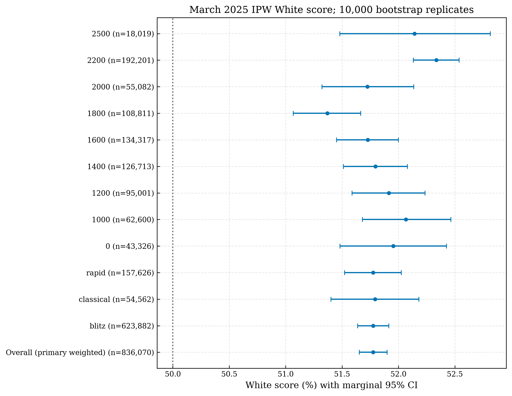
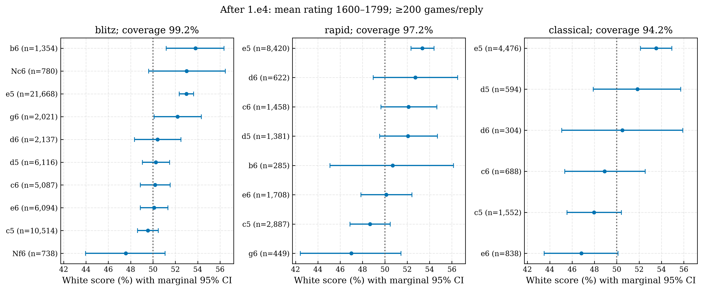

<div align="center">

# ♟️ White Lies


**Chess × Data × Probability**

</div>

## The finding

White scores **51.776%** (95% CI **51.653%–51.899%**) in the weighted eligible March 2025 Lichess population: **+1.776 percentage points** over 50%. One-sided Monte Carlo p=9.999e-05 (10,000-simulation resolution limit). Equal-rating standardization gives **51.886%** (dyadic CI 51.707%–52.064%).

Black's immediate reply is associated with score differences in **14/35 eligible cells** after BH correction; full W/D/B distributions differ in 15. H2 weakens markedly under near-equal-rating restrictions. These are **observational associations**, not causal claims or defense recommendations.

Read the [full research report](reports/FINAL_RESEARCH_REPORT.md), [short conclusion](reports/FINAL_CONCLUSION.md), [audit](reports/implementation_audit.md), and [verification checklist](reports/COMPLETION_CHECKLIST.md).

## Questions and outcome

- **H1:** H0 expected White score =0.50; one-sided H1 >0.50. Test the weighted overall population, then rating and speed groups with multiplicity correction.
- **H2:** Within first-move/speed/rating cells after 1.e4 or 1.d4, test equality of Black replies' W/D/B distributions and separately their score spread.

A win is 1, draw 0.5, loss 0. White score is **(W + D/2)/N**, different from White win probability. Primary analysis uses weights **1/sample_rate**; weighted totals are never treated as observed sample sizes.

## Verified data and scope

**March 1–31, 2025 only:** 836,070 sampled games from the [Lichess monthly rated-standard dump](https://database.lichess.org/), 97,512,351 source games scanned. All checksum, manifest, hash-selection, sampling-rate and record checks pass; 0 additional rows excluded. Includes blitz, rapid and classical; BOT titles, invalid ratings/results, other terminations and games below two plies were excluded by the collector. Resignations and legitimate short games are retained.

The sample is deterministic by game ID, with 1% base sampling and 10% classical/2200/2500-band overrides. Bands use mean opponent Elo. All collected bands enter H1; H2 uses bands >=1200 and >=200 observed games/reply. The archived Explorer CSV has unverified dates and is excluded. The legacy game CSV drops resignations and is excluded.

## Method and results

10,000-replicate sampling-aware Poisson multiplier bootstrap, draw-preserving multinomial null simulations, exact decisive-game binomial cross-checks where applicable, BH adjustment, equal-rating spline score regression and shared-player dyadic sensitivity. Prespecified choices are recorded in the audit. Independent-game and disjoint-player assumptions are explicit in the report.

| Group                      |       N | White score   | 95% CI          |   Above 50% (pp) |   Adjusted p | Interpretation           |
|:---------------------------|--------:|:--------------|:----------------|-----------------:|-------------:|:-------------------------|
| Overall (primary weighted) | 836,070 | 51.776%       | 51.653%–51.899% |            1.776 |    9.999e-05 | Score above 50% detected |
| blitz                      | 623,882 | 51.776%       | 51.637%–51.915% |            1.776 |    0.0001267 | Score above 50% detected |
| classical                  |  54,562 | 51.793%       | 51.402%–52.182% |            1.793 |    0.0001267 | Score above 50% detected |
| rapid                      | 157,626 | 51.776%       | 51.523%–52.024% |            1.776 |    0.0001267 | Score above 50% detected |

Near-equal-rating score: **51.819%** (CI 51.637%–52.004%, n=327,230). Band scores have no monotonic trend. Sensitivities preserve H1's direction, but the >=40-ply subset materially reduces its size. H2's median reply-score range is 6.24 pp; ranges are selected extremes with uncertainty, not objective opening values.





## Reproduce offline

```bash
python -m venv .venv
source .venv/bin/activate
python -m pip install -r requirements.txt
python -m src.run_analysis
python -m jupyter nbconvert --to notebook --execute --inplace analysis.ipynb --ExecutePreprocessor.timeout=600
python -m pytest -q
python tests/mock_run.py
```

The pipeline validates inputs before analysis, performs EDA/H1/H2/robustness, writes numerical tables and reports, exports 11 scientific figures in PNG/PDF, and checks outputs. It makes no network calls or large downloads. `--output-root /path/to/output` writes a separate artifact bundle. The notebook runs from the repository root using `src` imports. Seed: **202503**. Executed package versions: [software_versions.json](results/software_versions.json).

## Repository guide

| Location | Content |
|---|---|
| `analysis.ipynb` | Executed scientific notebook with interpretation |
| `src/validation.py` | Fail-closed provenance and counted cleaning |
| `src/stats.py`, `hypothesis_h1.py` | Reusable scores, bootstrap/null tests, weighting and adjustment |
| `src/h2.py`, `hypothesis_h2.py` | Existing spread test plus March grouping, coverage, full-distribution tests and BH |
| `src/run_analysis.py`, `plotting.py`, `reporting.py` | Offline execution, figures and data-driven documents |
| `src/fetch_games.py`, `explorer.py`, `wiki_scrape.py` | Preserved optional collectors and metadata helpers |
| `results/` | Provenance, EDA, H1/H2, sensitivity, model and source-availability tables |
| `figures/fig01_*` through `fig10_*` | Final March figures, plus H1 interval plot; each PNG and PDF |
| `reports/` | Audit, full report, short conclusion and verification |
| `tests/` | Analytic, synthetic calibration/power, provenance and artifact checks |

Old `q1_*`, `q2_*`, `draw_rate_by_band.*` and LaTeX artifacts are retained exploratory Explorer outputs; their dates are unverified. They do not support the March conclusions. `original_project/build_notebook.py` is an archived historical generator and must not replace the repaired notebook.

## Limits and optional future work

The study covers one site/month with selected rated game types. Ratings and opening choices are observational; repeated players limit independent-game inference. Near-equal H2 has less evidence, threshold decisions change, and high-rating classical cells are sparse. Explorer source alignment and full ECO mapping remain unverified. Full-year collection, Masters analysis and a dashboard are optional future work and have not been implemented. None is needed to reproduce this March case study.
