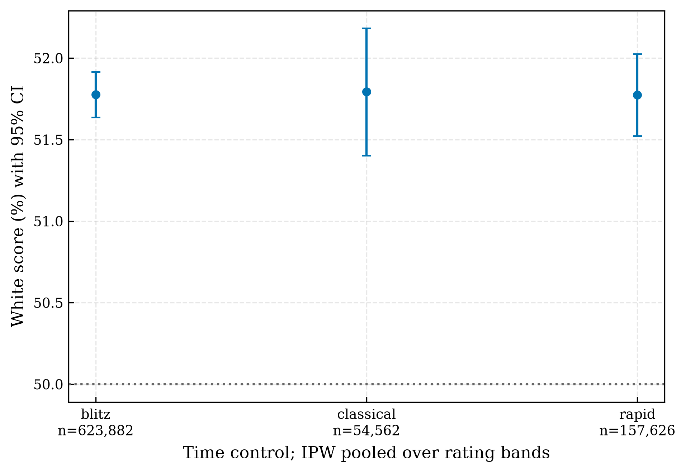
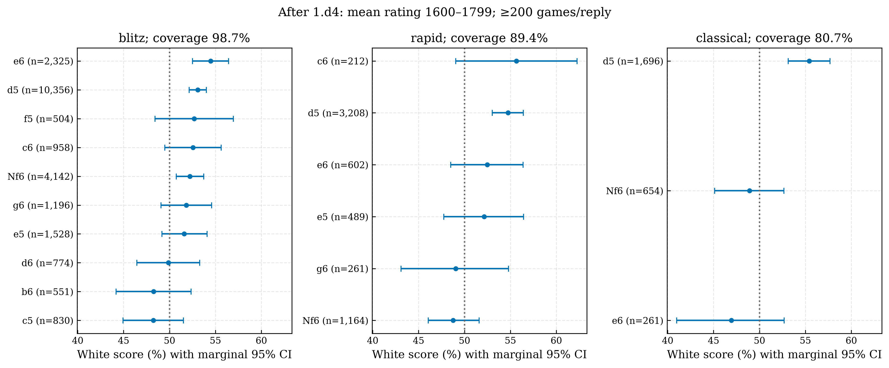

# Read the charts

Start with **03, White score by time control**, for a quick comparison. Use **H1, the complete interval view**, for the main White-score result. Charts **07 and 08** explain the reply comparisons.

**A point shows an estimated score. A line around it shows a 95% confidence interval.** A score of 50% means equal points for White and Black; it does not mean half the games were White wins.

All eleven charts come from the March 2025 analysis. Download the PNG or PDF for a closer look. Older charts based on data with unverified dates are excluded. The [data explorer](index.md) provides the values with filters, and the [full report](../research/report.md) gives the complete context.

## 01 · Observed chess outcomes

{ loading=lazy .research-figure }

**What it shows.** The sample contains 412,047 White wins, 43,748 draws and 380,275 Black wins.

**How to read it.** These are the recorded counts before weighting. A draw contributes half a point to White’s score.

**Keep in mind.** The collected sample includes some groups more often than others. Its raw outcome shares differ from the main weighted result.

[Full-resolution PNG](../assets/figures/fig01_game_outcomes.png){ .figure-link } · [PDF original](../assets/figures/fig01_game_outcomes.pdf){ .figure-link } · [Research context](../research/h1.md)

---

## 02 · White score by rating band

{ loading=lazy .research-figure }

**What it shows.** White’s score varies across rating bands, without a steady increase at higher ratings.

**How to read it.** Each point combines game speeds using sampling weights. Labels show sampled game counts and the lower end of each rating band. The 0 band means below 1000; 2500 means 2500 or above.

**Keep in mind.** Each interval covers its own estimate. The chart does not establish differences between every pair of bands or show that rating causes a change in the edge.

[Full-resolution PNG](../assets/figures/fig02_score_by_band.png){ .figure-link } · [PDF original](../assets/figures/fig02_score_by_band.pdf){ .figure-link } · [Research context](../research/h1.md)

---

## 03 · White score by time control

{ loading=lazy .research-figure }

**What it shows.** White’s weighted score is similar in blitz (51.776%), rapid (51.776%) and classical (51.793%) games.

**How to read it.** The points combine rating bands within each speed. Lines show 95% confidence intervals; sample counts are actual games studied.

**Keep in mind.** Close estimates do not prove the scores are exactly equal. They also do not show what would happen if a player changed game speed.

[Full-resolution PNG](../assets/figures/fig03_score_by_speed.png){ .figure-link } · [PDF original](../assets/figures/fig03_score_by_speed.pdf){ .figure-link } · [Research context](../research/h1.md)

---

## 04 · Draws across ratings and speeds

{ loading=lazy .research-figure }

**What it shows.** Draw frequency varies by rating band and game speed.

**How to read it.** Lines and marker shapes identify blitz, rapid and classical. Only speed-and-rating groups with at least 200 games appear. All games within one such group have the same sampling weight.

**Keep in mind.** Draw rate is different from White score. Lines connect observed groups; they do not estimate missing groups.

[Full-resolution PNG](../assets/figures/fig04_draw_rate_by_band.png){ .figure-link } · [PDF original](../assets/figures/fig04_draw_rate_by_band.pdf){ .figure-link } · [Research context](../methodology/statistics.md)

---

## 05 · The rating gap

{ loading=lazy .research-figure }

**What it shows.** The average White–Black rating gap is close to zero: −0.221 points, with a median of zero.

**How to read it.** The horizontal axis is White’s rating minus Black’s rating. Reference lines mark zero and the 25- and 100-point gaps used in checks.

**Keep in mind.** A near-zero average can hide many unequal pairings. It does not mean every pair of players was closely matched.

[Full-resolution PNG](../assets/figures/fig05_rating_imbalance.png){ .figure-link } · [PDF original](../assets/figures/fig05_rating_imbalance.pdf){ .figure-link } · [Research context](../methodology/ratings.md)

---

## 06 · Where the sample is dense

{ loading=lazy .research-figure }

**What it shows.** The number of sampled games differs greatly across speeds and ratings. The 2500+ classical group has just one game.

**How to read it.** Labels give actual game counts. The color scale uses powers of ten so that both large and small groups remain visible.

**Keep in mind.** Color shows sample size, not White’s advantage or statistical evidence. Some groups were deliberately sampled more often.

[Full-resolution PNG](../assets/figures/fig06_sample_coverage.png){ .figure-link } · [PDF original](../assets/figures/fig06_sample_coverage.pdf){ .figure-link } · [Research context](../methodology/sampling.md)

---

## 07 · Replies to 1.e4

{ loading=lazy .research-figure }

**What it shows.** Replies to 1.e4 have different recorded White scores in the 1600–1799 rating band.

**How to read it.** Each panel shows one speed. Every plotted reply has at least 200 sampled games in a tested group. Lines show each reply’s own 95% interval; labels include game counts.

**Keep in mind.** The order is based on observed scores. It does not establish the best defense, and the intervals do not account for selecting the highest or lowest reply.

[Full-resolution PNG](../assets/figures/fig07_replies_e4.png){ .figure-link } · [PDF original](../assets/figures/fig07_replies_e4.pdf){ .figure-link } · [Research context](../research/h2.md)

---

## 08 · Replies to 1.d4

{ loading=lazy .research-figure }

**What it shows.** Replies to 1.d4 have different recorded scores and levels of uncertainty in the 1600–1799 band.

**How to read it.** Each speed panel can contain different replies because the minimum game count is checked separately. The dotted line marks a White score of 50%.

**Keep in mind.** Whether one reply’s interval crosses 50% does not decide whether the replies differ from each other. That requires the separate group test.

[Full-resolution PNG](../assets/figures/fig08_replies_d4.png){ .figure-link } · [PDF original](../assets/figures/fig08_replies_d4.pdf){ .figure-link } · [Research context](../research/h2.md)

---

## 09 · Observed reply-score ranges

{ loading=lazy .research-figure }

**What it shows.** The gap between the highest and lowest reply scores varies across groups. The median gap is 6.24 percentage points.

**How to read it.** Each square summarizes one first-move, speed and rating group. Blank squares have too few eligible replies. Both panels use the same color scale.

**Keep in mind.** This shows observed ranges, not test decisions. Wide ranges can reflect sampling noise, especially when selecting extreme scores. A blank is not a zero difference.

[Full-resolution PNG](../assets/figures/fig09_reply_effect_heatmap.png){ .figure-link } · [PDF original](../assets/figures/fig09_reply_effect_heatmap.pdf){ .figure-link } · [Research context](../methodology/robustness.md)

---

## 10 · Observed spread and the simulated null

{ loading=lazy .research-figure }

**What it shows.** In these two example groups, the e4 score spread gives stronger evidence of reply differences than the d4 spread.

**How to read it.** Both groups use blitz games at ratings 1600–1799. The bars show 10,000 simulations with no reply differences; the vertical line shows the observed spread. The titles report adjusted test values.

**Keep in mind.** These are two examples, not a summary of all groups. The d4 score test does not pass the 0.05 adjusted threshold; the separate win/draw/loss test answers a different question.

[Full-resolution PNG](../assets/figures/fig10_h2_null_spread.png){ .figure-link } · [PDF original](../assets/figures/fig10_h2_null_spread.pdf){ .figure-link } · [Research context](../methodology/uncertainty.md)

---

## H1 · The complete interval view

{ loading=lazy .research-figure }

**What it shows.** The overall White-score interval lies above 50%, while estimates and precision vary across speeds and ratings.

**How to read it.** The point is a weighted score and the line is its 95% interval from 10,000 bootstrap repetitions. Labels show actual sampled game counts. The axis is enlarged around the scores.

**Keep in mind.** Each interval applies separately. The chart does not guarantee that every interval covers its target at once, or establish cause and effect.

[Full-resolution PNG](../assets/figures/h1_score_confidence_intervals.png){ .figure-link } · [PDF original](../assets/figures/h1_score_confidence_intervals.pdf){ .figure-link } · [Research context](../research/h1.md)

---

