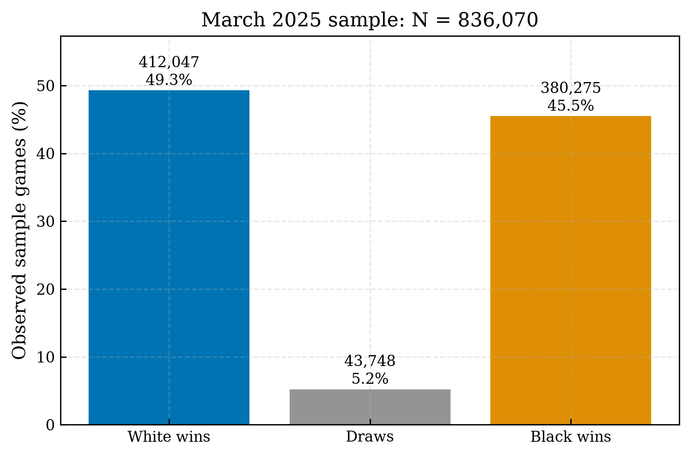
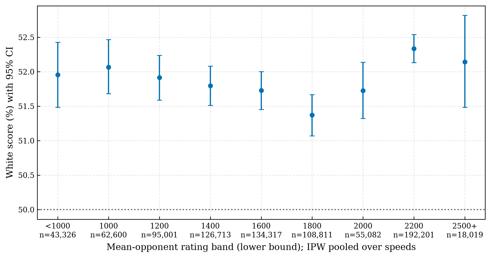
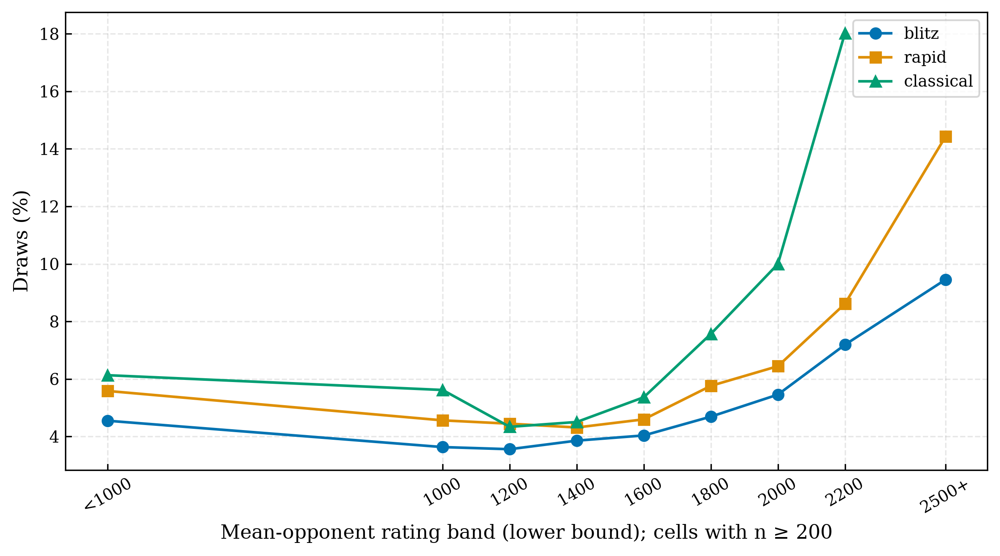
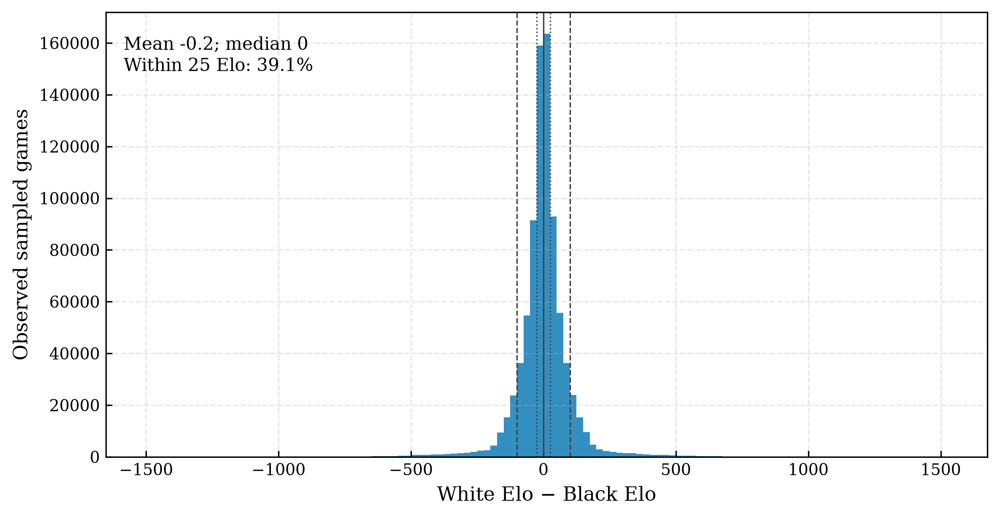
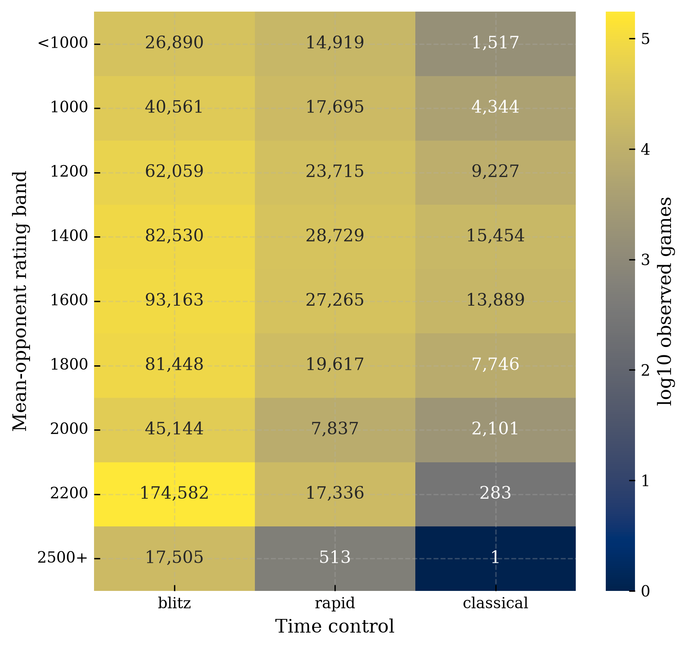
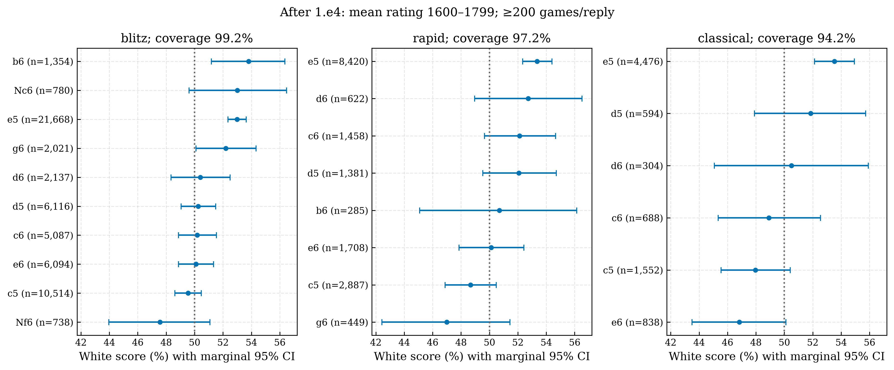
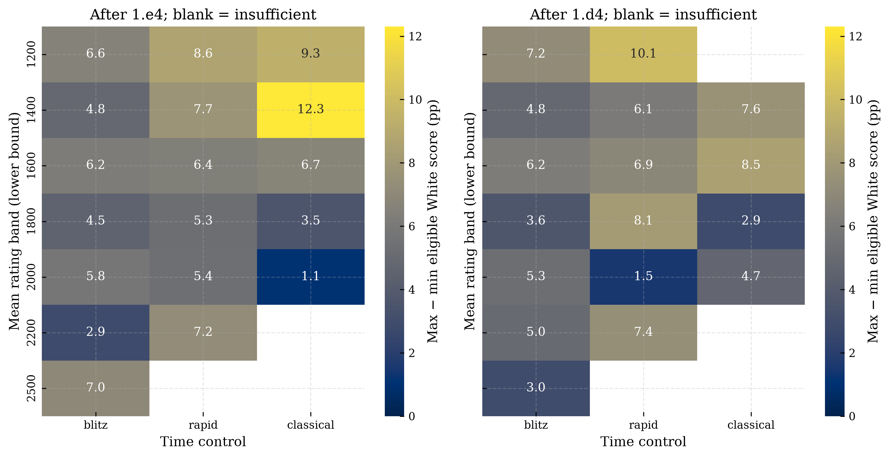
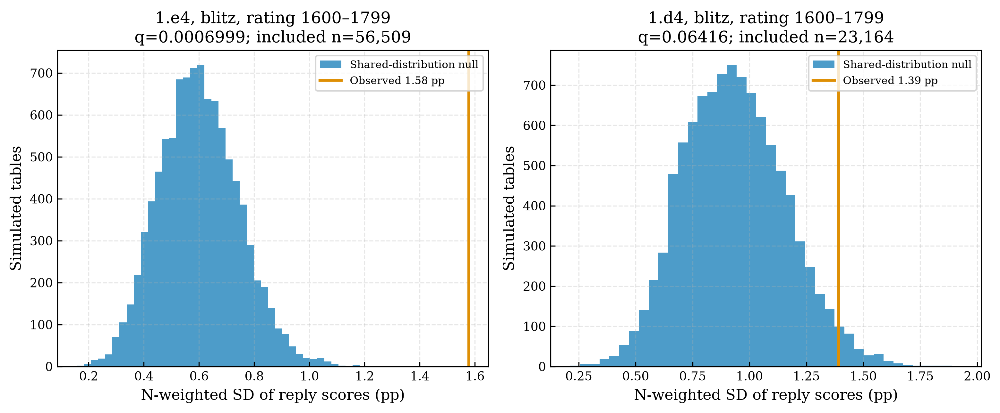
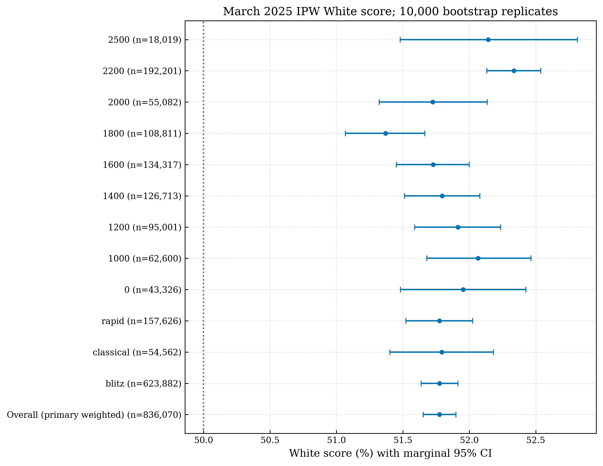

# Eleven views of the evidence

These are the final figures from the **March 2025 study**, exported by `src/plotting.py` at 300 dpi with PDF counterparts. Each caption distinguishes what is measured from what the visualization cannot establish. Open the full-resolution PNG or PDF for detailed inspection.

Historical `q1_*`, `q2_*` and `draw_rate_by_band.*` graphics use unverified Explorer data and are deliberately excluded. The [full report](../research/report.md) provides the surrounding scientific argument, and the [interactive explorer](index.md) provides accessible numeric estimates.

## 01 · Observed chess outcomes

{ loading=lazy .research-figure }

**Method.** The bars show observed sample proportions, not inverse-probability-weighted population shares. Draws supply half a point when computing White score.

**Reading.** White has more recorded wins than Black in this sample; draws are a separate outcome.

**Limit.** These raw counts do not equal the primary weighted outcome mix and do not identify a causal effect of moving first.

[Full-resolution PNG](../assets/figures/fig01_game_outcomes.png){ .figure-link } · [PDF original](../assets/figures/fig01_game_outcomes.pdf){ .figure-link } · [Research context](../research/h1.md)

---

## 02 · White score by rating band

{ loading=lazy .research-figure }

**Method.** Inverse-probability weighting pools speeds within each band. Labels show observed N and lower band bounds; 0 means below 1000 and 2500 means 2500+. The dotted line marks 50%.

**Reading.** Scores vary across bands without a monotonic increase with rating.

**Limit.** A sequence of point estimates is not a causal rating effect. Pointwise intervals are not simultaneous comparisons between every pair of bands.

[Full-resolution PNG](../assets/figures/fig02_score_by_band.png){ .figure-link } · [PDF original](../assets/figures/fig02_score_by_band.pdf){ .figure-link } · [Research context](../research/h1.md)

---

## 03 · White score by time control

{ loading=lazy .research-figure }

**Method.** Each speed estimate is pooled over rating bands using sampling weights. Sample sizes remain observed game counts. The interval widths reflect different available information.

**Reading.** Pooled scores are similar: blitz 51.776%, rapid 51.776% and classical 51.793%.

**Limit.** Similar estimates do not prove equality of time controls or establish a causal effect of changing game speed.

[Full-resolution PNG](../assets/figures/fig03_score_by_speed.png){ .figure-link } · [PDF original](../assets/figures/fig03_score_by_speed.pdf){ .figure-link } · [Research context](../research/h1.md)

---

## 04 · Draws across ratings and speeds

{ loading=lazy .research-figure }

**Method.** Within a speed-band cell, all sampling weights are constant, so weighting does not change the outcome proportion. Lines and marker shapes distinguish the three speeds.

**Reading.** Draw frequency varies with rating and speed; treating all games as binary wins and losses would discard this information.

**Limit.** Connecting observed cells does not fill sparse groups with estimates, and draw rates are not White scores.

[Full-resolution PNG](../assets/figures/fig04_draw_rate_by_band.png){ .figure-link } · [PDF original](../assets/figures/fig04_draw_rate_by_band.pdf){ .figure-link } · [Research context](../methodology/statistics.md)

---

## 05 · The rating gap

{ loading=lazy .research-figure }

**Method.** The histogram uses observed sampled games. The sample's mean gap is −0.221 Elo and median is zero. The near-equal subgroup uses an absolute gap of at most 25.

**Reading.** A near-zero average coexists with many unequal individual pairings.

**Limit.** An average rating gap near zero does not establish exchangeability, equal latent strength or absence of confounding.

[Full-resolution PNG](../assets/figures/fig05_rating_imbalance.png){ .figure-link } · [PDF original](../assets/figures/fig05_rating_imbalance.pdf){ .figure-link } · [Research context](../methodology/ratings.md)

---

## 06 · Where the sample is dense

{ loading=lazy .research-figure }

**Method.** Cell labels give raw N. Color uses log10 observed counts so large and small groups remain visible. The 10% inclusion overrides affect the observed composition.

**Reading.** Coverage is uneven, with especially sparse high-rating classical games; the 2500+ classical cell contains one game.

**Limit.** The color scale does not represent a population frequency, effect size or statistical significance.

[Full-resolution PNG](../assets/figures/fig06_sample_coverage.png){ .figure-link } · [PDF original](../assets/figures/fig06_sample_coverage.pdf){ .figure-link } · [Research context](../methodology/sampling.md)

---

## 07 · Replies to 1.e4

{ loading=lazy .research-figure }

**Method.** Only tested replies with at least 200 observed games appear. Panels report cell coverage. The original figure orders observed scores for readability; labels retain each reply's sample size.

**Reading.** Reply scores and their uncertainty differ within these specific groups; many intervals are wide.

**Limit.** The ordering does not establish objectively better defenses. These are marginal intervals around selected observations, not simultaneous ranking guarantees.

[Full-resolution PNG](../assets/figures/fig07_replies_e4.png){ .figure-link } · [PDF original](../assets/figures/fig07_replies_e4.pdf){ .figure-link } · [Research context](../research/h2.md)

---

## 08 · Replies to 1.d4

{ loading=lazy .research-figure }

**Method.** Eligibility is evaluated independently within each speed-band cell. The dotted line is the 50% scoring reference, not the omnibus comparison between replies.

**Reading.** Available replies and precision vary by time control, making coverage essential to interpretation.

**Limit.** An interval crossing 50% does not decide the cell's H2 test, and the selected score extremes are not causal defense values.

[Full-resolution PNG](../assets/figures/fig08_replies_d4.png){ .figure-link } · [PDF original](../assets/figures/fig08_replies_d4.pdf){ .figure-link } · [Research context](../research/h2.md)

---

## 09 · Observed reply-score ranges

{ loading=lazy .research-figure }

**Method.** The range is descriptive and uses observed extremes after applying reply thresholds. Both panels share a color scale. This is a range plot, not a significance map.

**Reading.** Observed ranges vary across the tested cells; the median is 6.24 percentage points.

**Limit.** Large ranges can reflect sparse replies and selection noise. A blank cell does not show a zero effect, and color alone does not establish a corrected rejection.

[Full-resolution PNG](../assets/figures/fig09_reply_effect_heatmap.png){ .figure-link } · [PDF original](../assets/figures/fig09_reply_effect_heatmap.pdf){ .figure-link } · [Research context](../methodology/robustness.md)

---

## 10 · Observed spread and the simulated null

{ loading=lazy .research-figure }

**Method.** Each histogram uses 10,000 simulations under a shared White/Draw/Black distribution. A vertical line shows the observed spread; titles give the score-test q-value and included N.

**Reading.** The observed e4 spread is more incompatible with its null than the d4 spread; the d4 score test does not pass the 0.05 corrected threshold.

**Limit.** These two representative cells do not summarize every H2 group, and the score-spread statistic does not replace the separate full-distribution test.

[Full-resolution PNG](../assets/figures/fig10_h2_null_spread.png){ .figure-link } · [PDF original](../assets/figures/fig10_h2_null_spread.pdf){ .figure-link } · [Research context](../methodology/uncertainty.md)

---

## H1 · The complete interval view

{ loading=lazy .research-figure }

**Method.** The horizontal forest plot uses 10,000 bootstrap replicates and a 50% reference line. Its axis focuses on the estimated scores; read percentage labels rather than interpreting line length as a zero-based bar.

**Reading.** The primary interval lies above 50%, while group precision and point estimates vary.

**Limit.** Marginal intervals do not provide simultaneous coverage or establish causal differences across overlapping subgroups.

[Full-resolution PNG](../assets/figures/h1_score_confidence_intervals.png){ .figure-link } · [PDF original](../assets/figures/h1_score_confidence_intervals.pdf){ .figure-link } · [Research context](../research/h1.md)

---

