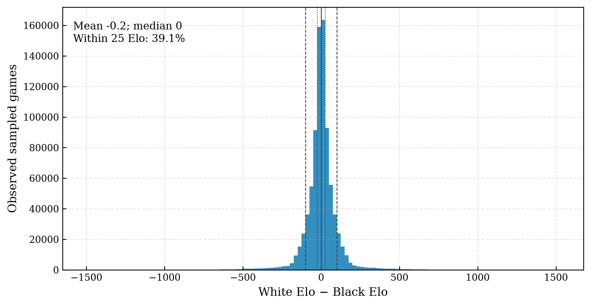
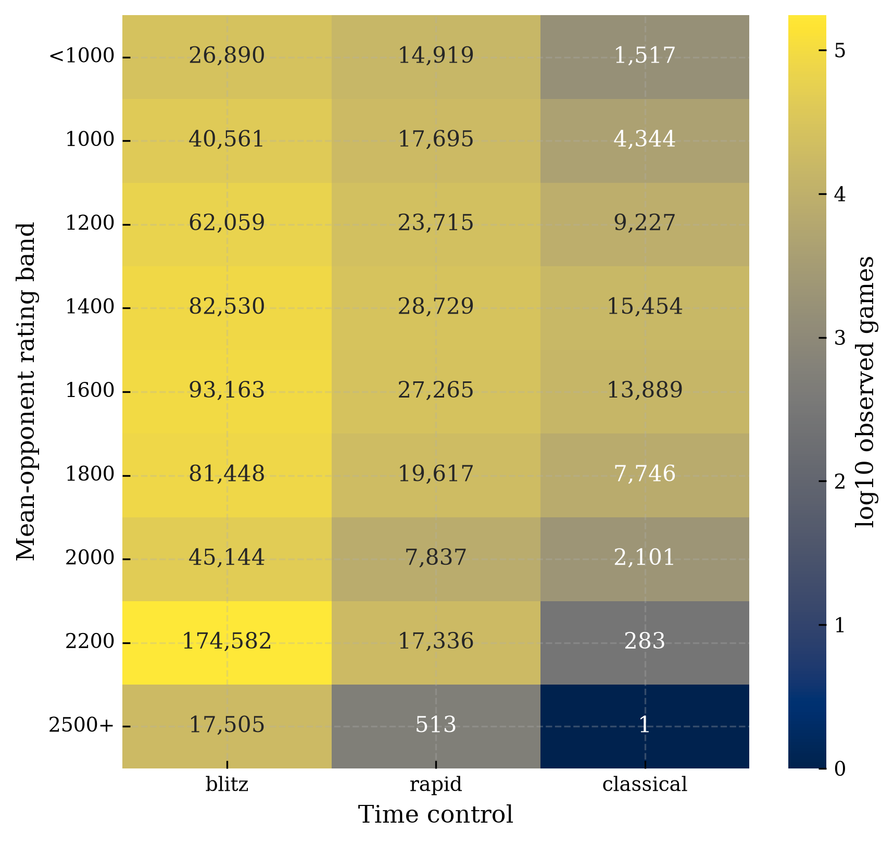

# 2. From archive to checked sample

**97.5 million games scanned → 836,070 sampled games → 0 further cleaning exclusions.**

## 1. Collect { #step-1-fetch-and-read-the-archive }

We streamed the **March 2025 Lichess archive**, reading it as it downloaded. This covered the whole month without storing the full 31.8 GB compressed file.

??? info "Source and earlier data"
    Games were played **March 1–31, 2025** and collected in November 2026. The scan read **97,512,351 games** and **31,787,738,173 compressed bytes**.

    The older sample excluded resignations, stopped early within groups and lacked dates and player names. It remains archived. The March sample keeps valid resignations and supports full-month and shared-player checks.

    Routine analysis uses the saved sample; it does not download the archive again.

## 2. Select games { #step-2-apply-eligibility-rules-and-sample-by-game-id }

We kept rated **blitz, rapid and classical** games with valid ratings and results, no BOT-titled player, and at least two individual moves. Valid short games and resignations stay included.

| Game group | Sampling rate | Weight |
| --- | ---: | ---: |
| Most eligible games | 1% | 100 |
| Classical or rating bands starting at 2200+ | 10% | 10 |

Each game ID gives a repeatable selection number. A larger sampling rate helps retain enough less-common games.

??? info "Sampling rule and complete counts"
    A game is selected when its hash number $u_i$ is below its sampling rate $\pi_i$:

    $$
    u_i < \pi_i.
    $$

    The number uses the first eight hexadecimal characters of the ID's MD5 hash. Selection is treated as approximately random Bernoulli sampling. The 10% override applies once, even when both conditions match.

    The sample contains **571,572 records at 1%** and **264,498 at 10%**. Normal and Time forfeit endings are eligible. The hash decision precedes move parsing; the two-ply rule follows selection.

    | First exclusion rule | Games |
    | --- | ---: |
    | Unsupported speed | 37,351,463 |
    | Invalid rating | 0 |
    | Invalid result | 1,310 |
    | Unsupported ending | 188,228 |
    | BOT title | 162,871 |
    | Fewer than two plies among selected candidates | 210 |

    Another **58,972,199** games were not sampled. Sequential counts avoid double-counting exclusions:

    $$
    N_{\text{scanned}}=N_{\text{saved}}+N_{\text{not sampled}}+N_{\text{excluded}}.
    $$

    A likely resignation is flagged from a decisive Normal ending without a final checkmate move. This heuristic is not an exclusion rule.

## 3. Validate and clean { #step-3-save-and-validate-the-sample }

**All 17 file checks passed.** The sample agrees with its collection record, including dates, counts, sampling rules and checksum.

<span id="step-4-check-and-clean-individual-records"></span>

**All 16 record checks passed too.** No missing or duplicate IDs, invalid results, broken player records or inconsistent fields required further exclusions.

??? info "What was checked"
    The Parquet file stores the sampled rows. Its adjacent **manifest** records the source, settings, completion status, counts and SHA-256 fingerprint.

    Checks cover file identity, columns, dates, group counts, hash decisions and balanced source accounting. A matching checksum confirms local agreement, not independent authentication of the remote archive.

    Record checks cover IDs, ratings, results, dates, speed, rating band, sampling rate, bot titles, endings, game length, first move, reply, player names, self-pairings and the time-forfeit flag. Missing titles mean untitled players and are valid.

    Settings: `sample_rate=0.01`, `rate_override=classical=0.10,2200=0.10,2500=0.10`, `band_by=avg`, `min_plies=2`, no collection limit.

    SHA-256:

    ```text
    e055e8f921b3b242188c0493d57acc8fe83a2200ee0223e6cb817dc5a627ffaa
    ```

## 4. Prepare the analysis { #step-5-prepare-the-fields-used-in-analysis }

For each game, we create a **White score, rating gap, rating band and sampling weight**. We also keep the first move and Black's reply.

Weights correct the sample mix: a game selected at 1% represents 100 games; one selected at 10% represents 10.

??? info "Prepared fields and weighting formulas"
    - Average rating: $r_i=\lfloor(\text{White Elo}_i+\text{Black Elo}_i)/2\rfloor$.
    - Rating gap: $\Delta_i=\text{White Elo}_i-\text{Black Elo}_i$.
    - Gap categories: at most 25, 26–100, or above 100 rating points.
    - White score: $Y_i=1,0.5,0$ for win, draw, loss.
    - Reply group: first move + speed + rating band + reply.

    The band lower bounds are **0, 1000, 1200, 1400, 1600, 1800, 2000, 2200, 2500**. Zero means below 1000; 2200 covers 2200–2499; 2500 means 2500+. Ratings are Lichess speed ratings.

    Parsing removes move annotations and normalizes dates. Source-supplied opening labels remain descriptive; no complete new opening-code mapping was validated.

    $$
    \widehat S=\frac{\sum_i w_iY_i}{\sum_i w_i}, \qquad w_i=\frac{1}{\pi_i}.
    $$

    The weights represent an estimated **59,802,180 eligible games**, not new observations. Their effective sample size describes unequal weights:

    $$
    N_{\text{eff}}=\frac{(\sum_i w_i)^2}{\sum_i w_i^2}\approx622{,}813,
    $$

    Neither weighted totals nor effective sample size count independent players.

## 5. Inspect the sample { #step-6-inspect-the-prepared-data }

The first plots check rating balance and data coverage before testing the hypotheses.

### Graph 05 — Rating gaps { #graph-05-are-opponents-closely-matched }

<figure class="study-figure" markdown="1">
<div class="study-figure__meta"><span>FIGURE 05</span><span class="study-figure__type">Histogram</span></div>

[{ loading=lazy .research-figure }](../assets/figures/fig05_rating_imbalance.png){ .study-figure__image-link }

<figcaption markdown="1">
<p class="study-figure__takeaway">A balanced average hides unequal opponents.</p>
<div class="study-figure__notes" markdown="1">
<div markdown="1">
**Read the graph**

Horizontal: White rating minus Black rating. Bars: sampled games.
</div>
<div markdown="1">
**What it means**

The mean gap is −0.221 points, but individual pairings can be unequal.
</div>
</div>
<div class="study-figure__caution" markdown="1">
**Keep in mind:** Similar ratings do not guarantee equal strength.
</div>

[Open full-size graph](../assets/figures/fig05_rating_imbalance.png){ .study-figure__download } · [PDF](../assets/figures/fig05_rating_imbalance.pdf){ .study-figure__download }
</figcaption>
</figure>

### Graph 06 — Sample coverage { #graph-06-where-do-we-have-enough-games }

<figure class="study-figure" markdown="1">
<div class="study-figure__meta"><span>FIGURE 06</span><span class="study-figure__type">Heatmap</span></div>

[{ loading=lazy .research-figure }](../assets/figures/fig06_sample_coverage.png){ .study-figure__image-link }

<figcaption markdown="1">
<p class="study-figure__takeaway">Some groups have very few games.</p>
<div class="study-figure__notes" markdown="1">
<div markdown="1">
**Read the graph**

Rows: rating bands. Columns: speeds. Labels: game counts; colors use a log scale.
</div>
<div markdown="1">
**What it means**

The 2500+ classical group contains just one game.
</div>
</div>
<div class="study-figure__caution" markdown="1">
**Keep in mind:** Color shows sample size, not the size of an advantage.
</div>

[Open full-size graph](../assets/figures/fig06_sample_coverage.png){ .study-figure__download } · [PDF](../assets/figures/fig06_sample_coverage.pdf){ .study-figure__download }
</figcaption>
</figure>

[Detailed data checks](../methodology/data.md) · [Sampling methods](../methodology/sampling.md)

**Next: [3. Does White score more? →](h1.md)**
