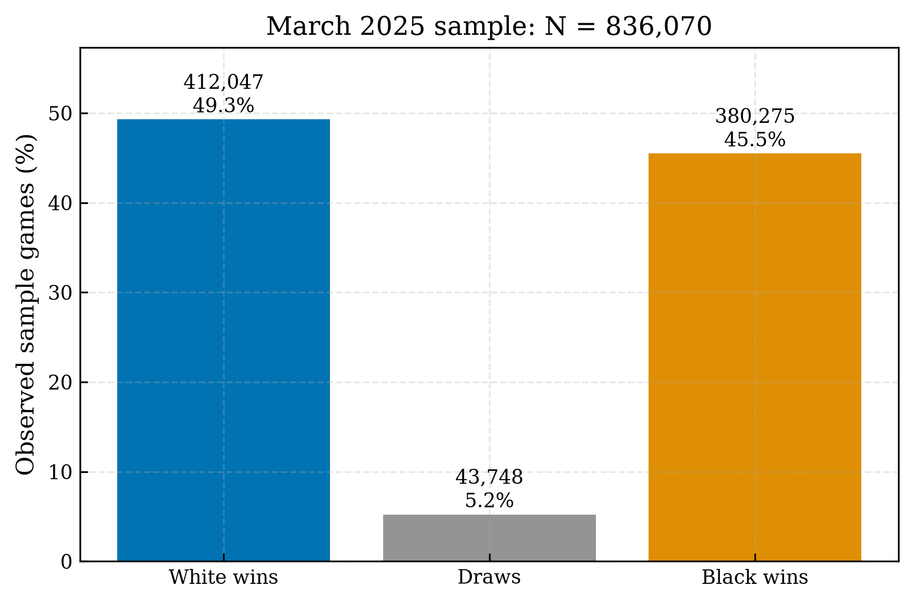
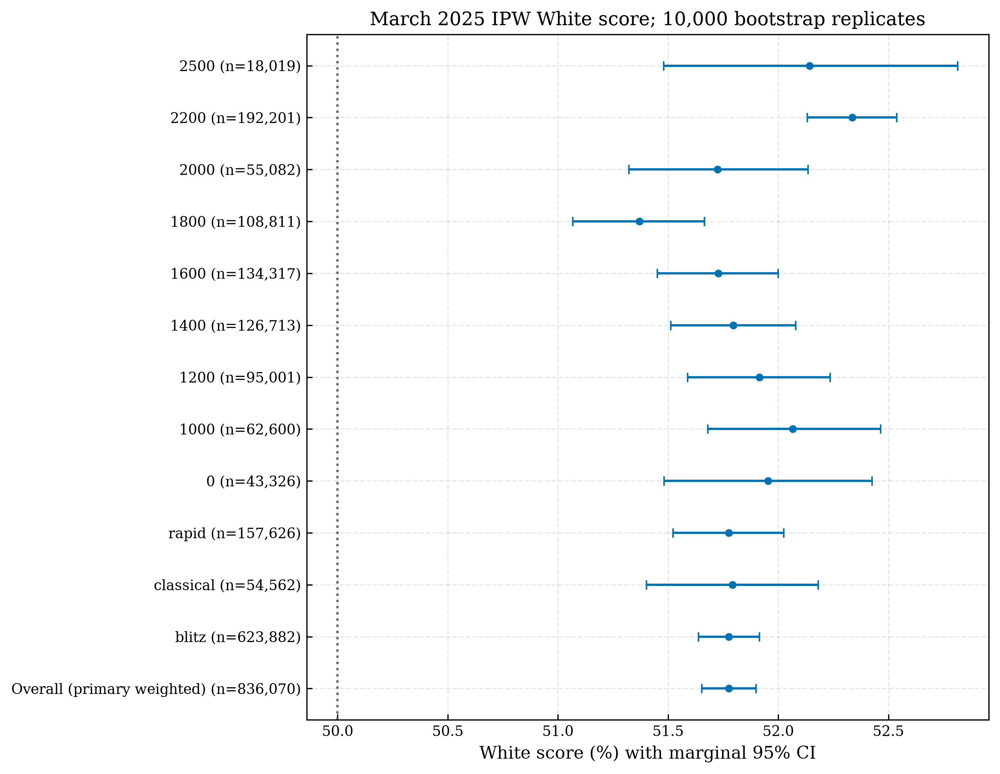
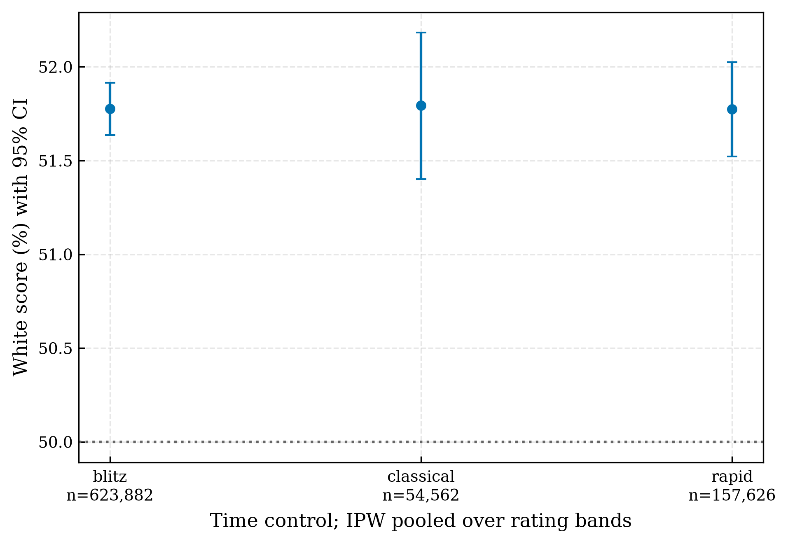
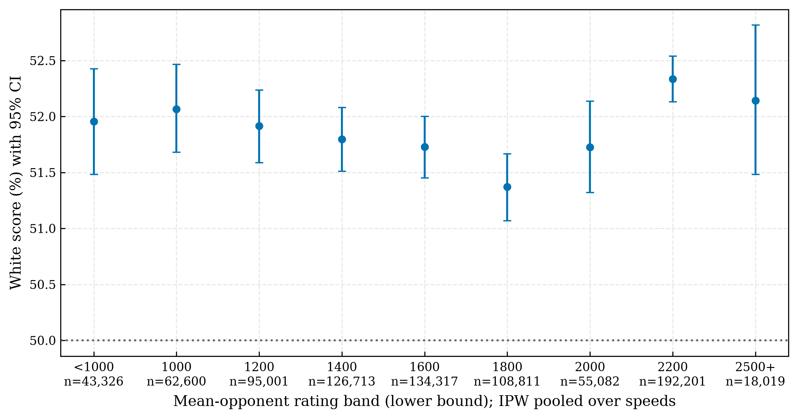
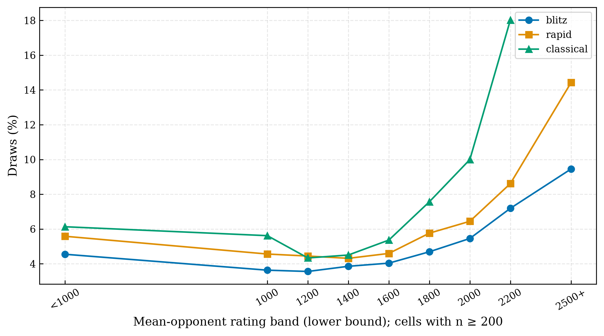

# 3. Does White score more?

**White earned about 51.8% of the points.**

Exact estimate: **51.776%**. The 95% confidence interval is **51.653%–51.899%**.

## 1. The question { #step-1-define-the-comparison }

We compare White's average score with **50%**, the equal-score benchmark.

$$
H_0:E[Y]=0.50, \qquad H_1:E[Y]>0.50.
$$

The test looks specifically for a score above 50%, using a planned 0.05 threshold.

## 2. The recorded outcomes { #step-2-inspect-the-recorded-outcomes }

### Graph 01 — Game outcomes { #graph-01-what-happened-in-the-sampled-games }

<figure class="study-figure" markdown="1">

FIGURE 01Bar chart

[{ loading=lazy .research-figure }](../assets/figures/fig01_game_outcomes.png){ .study-figure__image-link }

<figcaption markdown="1">

White won more games than Black.

**Read the graph**

Each bar shows one outcome as a share of sampled games.

**What it means**

Counting draws, White’s raw score is 51.900%.

**Keep in mind:** These are raw sample counts, before weighting.

[Open full-size graph](../assets/figures/fig01_game_outcomes.png){ .study-figure__download } · [PDF](../assets/figures/fig01_game_outcomes.pdf){ .study-figure__download }
</figcaption>
</figure>

## 3. The weighted score { #step-3-calculate-the-score-and-apply-weights }

Some groups were sampled more often. We correct for that by weighting each game's points:

$$
\widehat S=\frac{\sum_i w_iY_i}{\sum_i w_i}=0.5177632\approx51.776\%.
$$

The result is **1.776 percentage points above 50%**. It is a score, not a win rate: White's weighted win rate is **49.533%**.

??? info "Score calculation and outcome rates"
    The raw sample score is slightly higher:

    $$
    S_{\text{raw}}=\frac{412{,}047+43{,}748/2}{836{,}070}=0.5190008\approx51.900\%.
    $$

    Weighting reduces it by **0.124 percentage points**. Each game's weight is $1/\pi_i$, the inverse of its sampling rate.

    $$
    100(\widehat S-0.50)=1.776\text{ percentage points}.
    $$

    | Weighted measure | Result |
    | --- | ---: |
    | White wins | 49.533% |
    | Draws | 4.486% |
    | Black wins | 45.980% |
    | White score | 51.776% |
    | White win rate among decisive games | 51.860% |

    The raw draw rate is 5.233%. Differences from the weighted values reflect the sample mix; displayed totals can differ slightly through rounding.

## 4. How strong is the evidence? { #step-4-measure-uncertainty-and-test-the-benchmark }

- **Estimate uncertainty:** 10,000 bootstrap repetitions give the 95% interval above.
- **Test equal scoring:** 10,000 simulations keep draws but give White and Black equal winning chances. None reached the observed score; **p ≈ 0.0001**.
- **Check another way:** a Wald test and an exact unweighted decisive-game test support the same direction.

The interval shows uncertainty around the average score. It stays above 50%, giving strong evidence of a **small scoring difference** under the method’s assumptions.

??? info "Bootstrap and simulation formulas"
    A bootstrap varies the observed counts and recalculates the estimate. Its 95% interval uses the 2.5th and 97.5th percentiles:

    $$
    CI_{95\%}=[Q_{0.025}(\widehat S^*),Q_{0.975}(\widehat S^*)].
    $$

    For outcome count $C_{go}$ in speed-rating group $g$, repetition $b$ uses:

    $$
    M_{go}^{(b)}\sim\operatorname{Poisson}(C_{go}), \qquad
    C_{go}^{*(b)}=C_{go}+\sqrt{1-\pi_g}(M_{go}^{(b)}-C_{go}).
    $$

    Counts vary in both parts of the weighted ratio. The square-root term corrects for the 1% or 10% sampling fraction; the unweighted check omits it.

    Under equal winning chances, preserve group draw probability $d_g$:

    $$
    (W_g^*,D_g^*,B_g^*)\sim\operatorname{Multinomial}\left(n_g;
    \frac{1-d_g}{2},d_g,\frac{1-d_g}{2}\right).
    $$

    Combine groups using their original weights and sample sizes, then calculate:

    $$
    p_{MC}=\frac{1+\#\{\widehat S_{\text{null}}^*\ge\widehat S\}}{R+1}, \qquad R=10{,}000.
    $$

    The seed is **202503**. The minimum reportable p-value is **1/10001 ≈ 9.999e-05**, not zero or an exact probability below that limit.

    The null simulation does not use the bootstrap's finite-population scaling. It assumes independent games and equal winning chances within every group, a stronger null than an overall mean of 50% alone.

    Confidence intervals describe estimate uncertainty, not individual game outcomes. Their coverage and the test results depend on these assumptions.

??? info "Wald and exact-binomial checks"
    The Wald test measures distance above 50% in standard-error units:

    $$
    \widehat V=\frac{\sum_i(1-\pi_i)w_i^2(Y_i-\widehat S)^2}{(\sum_i w_i)^2}, \qquad
    Z=\frac{\widehat S-0.50}{\sqrt{\widehat V}}.
    $$

    Its one-sided p-value is **3.33 × 10⁻¹⁸³**. It tests the pooled mean directly.

    With equal weights or no weights, the decisive-game check uses:

    $$
    W\mid(W+B)\sim\operatorname{Binomial}(W+B,0.5).
    $$

    The raw-sample exact p-value is **2.159 × 10⁻²⁷⁹**. This is not an exact test of the unequal-weight pooled score.

## 5. The pattern across groups { #step-5-read-the-main-result-and-its-group-patterns }

### H1 — The overall result { #h1-interval-graph-the-overall-result-in-context }

<figure class="study-figure" markdown="1">

FIGURE H1Forest plot

[{ loading=lazy .research-figure }](../assets/figures/h1_score_confidence_intervals.png){ .study-figure__image-link }

<figcaption markdown="1">

White’s overall interval is above 50%.

**Read the graph**

Dot: weighted score. Line: 95% interval. Dashed reference: 50%.

**What it means**

White’s overall score is 51.776%; precision varies across groups.

**Keep in mind:** Each interval covers one estimate; it does not test every pair of groups.

[Open full-size graph](../assets/figures/h1_score_confidence_intervals.png){ .study-figure__download } · [PDF](../assets/figures/h1_score_confidence_intervals.pdf){ .study-figure__download }
</figcaption>
</figure>

### Graph 03 — Game speed { #graph-03-does-the-pattern-appear-at-different-speeds }

<figure class="study-figure" markdown="1">

FIGURE 03Point-and-interval chart

[{ loading=lazy .research-figure }](../assets/figures/fig03_score_by_speed.png){ .study-figure__image-link }

<figcaption markdown="1">

The three speeds give similar scores.

**Read the graph**

Categories: game speeds. Height: weighted White score. Lines: 95% intervals.

**What it means**

Blitz, rapid and classical all score about 51.8% for White.

**Keep in mind:** Close estimates do not prove exact equality.

[Open full-size graph](../assets/figures/fig03_score_by_speed.png){ .study-figure__download } · [PDF](../assets/figures/fig03_score_by_speed.pdf){ .study-figure__download }
</figcaption>
</figure>

### Graph 02 — Player ratings { #graph-02-does-the-edge-grow-with-rating }

<figure class="study-figure" markdown="1">

FIGURE 02Point-and-interval chart

[{ loading=lazy .research-figure }](../assets/figures/fig02_score_by_band.png){ .study-figure__image-link }

<figcaption markdown="1">

The edge does not rise steadily with rating.

**Read the graph**

Horizontal: rating bands. Vertical: weighted White score. Lines: 95% intervals.

**What it means**

Scores range from 51.370% in the 1800 band to 52.336% in the 2200 band.

**Keep in mind:** Differences between rating groups do not establish cause and effect.

[Open full-size graph](../assets/figures/fig02_score_by_band.png){ .study-figure__download } · [PDF](../assets/figures/fig02_score_by_band.pdf){ .study-figure__download }
</figcaption>
</figure>

### Graph 04 — Draw rates { #graph-04-why-keep-draws-in-the-analysis }

<figure class="study-figure" markdown="1">

FIGURE 04Line chart

[{ loading=lazy .research-figure }](../assets/figures/fig04_draw_rate_by_band.png){ .study-figure__image-link }

<figcaption markdown="1">

Draw frequency changes with rating and speed.

**Read the graph**

Horizontal: rating bands. Vertical: draw percentage. Each line is a speed.

**What it means**

Draws are part of the result, so they must count toward White’s score.

**Keep in mind:** Only groups with at least 200 games are shown.

[Open full-size graph](../assets/figures/fig04_draw_rate_by_band.png){ .study-figure__download } · [PDF](../assets/figures/fig04_draw_rate_by_band.pdf){ .study-figure__download }
</figcaption>
</figure>

**36 of 38 eligible subgroup tests** detect a score above 50% after adjustment for multiple tests.

??? info "Exact subgroup results and test adjustment"
    | Speed | Sampled games | White score | 95% interval |
    | --- | ---: | ---: | --- |
    | Blitz | 623,882 | 51.776% | 51.637%–51.915% |
    | Rapid | 157,626 | 51.776% | 51.523%–52.024% |
    | Classical | 54,562 | 51.793% | 51.402%–52.182% |

    All 3 speed tests, all 9 rating-band tests and 24 of 26 speed-rating tests pass the adjusted threshold. Classical 2200–2499 (283 games) and rapid 2500+ (513 games) are inconclusive. Classical 2500+ has one game and is not tested.

    Subgroup tests require **200 games and 20 decisive outcomes**. Benjamini–Hochberg adjustment covers the 38 eligible tests; the overall planned test stays separate. Sort $m$ p-values to obtain:

    $$
    q_{(i)}=\min\left(1,\min_{j\ge i}\frac{m\,p_{(j)}}{j}\right).
    $$

    Compare adjusted values with 0.05. Related tests and repeated players limit the procedure's usual guarantees. Individual intervals are not adjusted to cover every group simultaneously.

## 6. Do the checks agree? { #step-6-check-ratings-and-repeated-players }

| Check | White score |
| --- | ---: |
| Players within 25 rating points | **51.819%** |
| Model comparing equal ratings | **51.886%** |
| Games lasting at least 40 individual moves | **50.769%** |

White stays above 50%, but the size of the edge changes. [All checks and limits →](limitations.md)

??? info "Rating model and shared-player checks"
    Closely matched ratings retain **327,230 games**, with a **51.637%–52.004%** interval.

    The rating model fits a separate baseline per speed-rating group and a smooth shared rating-gap curve:

    $$
    E[Y_i\mid c_i,\Delta_i]=\alpha_{c_i}+f(\Delta_i), \qquad
    \widehat S_{\text{equal}}=\frac{\sum_c W_c\,\widehat m_c(0)}{\sum_c W_c}.
    $$

    $W_c$ is group $c$'s total sampling weight; $\widehat m_c(0)$ predicts its score at equal ratings. The natural cubic spline has knots at **−200, −50, 0, 50, 200**.

    One sparse row is omitted, leaving **836,069 games**. The model has full rank and no fitted scores outside 0–1. It shares one rating curve and has no individual player-skill effects.

    The model's shared-player interval is **51.707%–52.064%**. Allowing shared players for the original mean gives **51.655%–51.898%**. These are model-based checks, not causal experiments.

## 7. Conclusion

**White shows a small scoring edge in these games.** Rating checks support its direction; game selection changes its size. The data do not prove that moving first causes the whole difference.

[Detailed H1 methods](../methodology/statistics.md) · [Uncertainty](../methodology/uncertainty.md)

**Next: [4. Does Black's reply matter? →](h2.md)**
