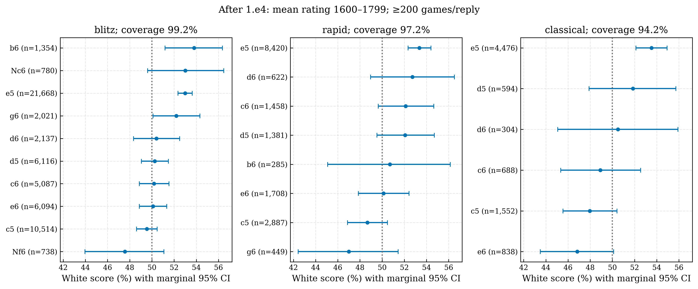
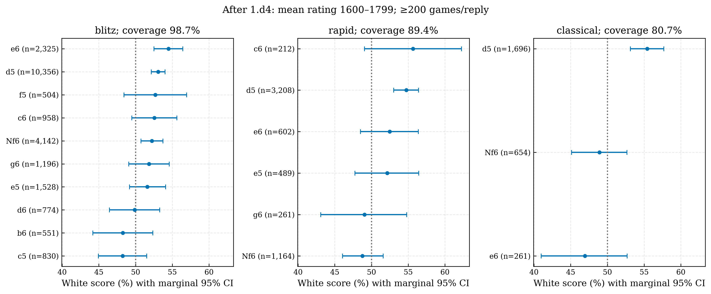
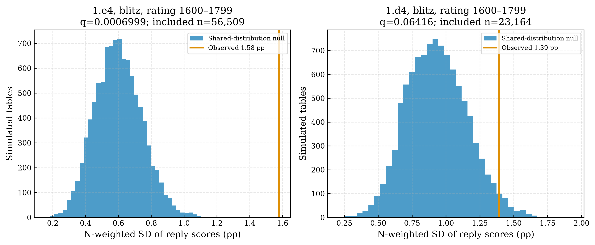
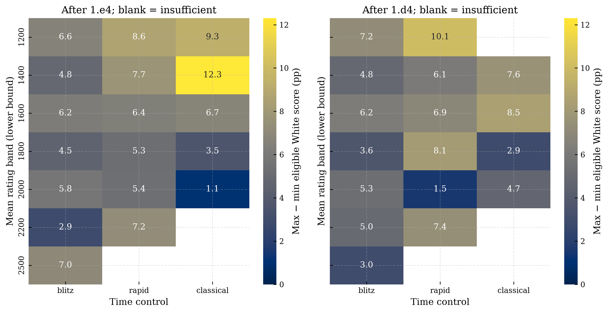

# 4. Does Black's reply matter?

**Some replies have different recorded outcomes.**

After adjustment, **14 of 35 groups** show score differences and **15 of 35** show win/draw/loss differences. The evidence weakens among closely matched players.

## 1. Compare similar games { #step-1-define-the-hypothesis-and-comparison-groups }

After `1.e4` or `1.d4`, compare replies within the **same speed and rating band**. One such group is called a **cell**.

The starting assumption is that all replies in a cell share the same outcome probabilities.

??? info "Formal hypothesis"
    For reply $j$, $\boldsymbol\theta_j$ contains its White-win, draw and Black-win probabilities. With $k$ eligible replies:

    $$
    H_0:\boldsymbol\theta_1=\cdots=\boldsymbol\theta_k, \qquad
    H_1:\text{at least two outcome distributions differ}.
    $$

    A separate test asks whether average scores differ. For example, 50 wins plus 50 losses and 100 draws both score 50%, despite very different outcomes.

## 2. Keep replies with enough data { #step-2-decide-which-replies-have-enough-data }

Each tested group needs:

- A rating band starting at **1200 or above**.
- At least **200 sampled games per reply**.
- At least **two eligible replies**.

This gives **35 groups containing 602,437 games**.

??? info "Coverage and sampling"
    Of **714,224** e4/d4 games, tested replies cover **84.35%** overall and **96.95%** within the eligible rating bands:

    $$
    \text{Coverage}=\frac{\text{games in eligible replies, if the group can be tested}}{\text{all observed games in the group}}.
    $$

    Rules were recorded before examining outcomes. Replies can qualify in one group and fail in another. Groups without two eligible replies remain untested, with exclusion flags saved.

    Sampling weights are constant within a speed-rating group, so they cancel in reply scores. H2 uses observed counts. The older Explorer code's 10,000-game floor does not apply to this March analysis.

## 3. Calculate each reply's score { #step-3-calculate-and-plot-each-replys-score }

Count a win as 1, a draw as ½ and a loss as 0:

$$
S_j=\frac{W_j+D_j/2}{n_j}.
$$

Here, $n_j$ is the number of games after reply $j$. Each plotted reply also has a **95% confidence interval**.

??? info "Reply intervals"
    Use a **10,000-repetition multinomial bootstrap**: draw the same number of games from the reply's observed outcome proportions, recalculate the score, and keep the 2.5th–97.5th percentiles.

    Below 200 games, or with only one observed outcome category, use conservative exact bounds for White and Black win probabilities:

    $$
    S_j=\frac{1+P_j(W)-P_j(B)}{2}.
    $$

    The bounds jointly cover those two probabilities for one reply. They do not cover all replies simultaneously or correct for selecting extreme scores.

### Graph 07 — Replies to e4 { #graph-07-replies-after-1e4 }

<figure class="study-figure" markdown="1">

FIGURE 07Three-panel forest plot

[{ loading=lazy .research-figure }](../assets/figures/fig07_replies_e4.png){ .study-figure__image-link }

<figcaption markdown="1">

Replies to e4 have different recorded scores.

**Read the graph**

Rating 1600–1799. Panels: speeds. Rows: replies. Dots and lines: scores and 95% intervals.

**What it means**

Wider intervals mean less precise score estimates.

**Keep in mind:** The observed order of scores is not a ranking of defense strength.

[Open full-size graph](../assets/figures/fig07_replies_e4.png){ .study-figure__download } · [PDF](../assets/figures/fig07_replies_e4.pdf){ .study-figure__download }
</figcaption>
</figure>

### Graph 08 — Replies to d4 { #graph-08-replies-after-1d4 }

<figure class="study-figure" markdown="1">

FIGURE 08Three-panel forest plot

[{ loading=lazy .research-figure }](../assets/figures/fig08_replies_d4.png){ .study-figure__image-link }

<figcaption markdown="1">

Reply scores and precision vary by speed.

**Read the graph**

Rating 1600–1799. Panels: speeds. Each reply has a score and 95% interval.

**What it means**

Some intervals are wide, so the order of replies is uncertain.

**Keep in mind:** One reply’s interval does not decide the whole-group test.

[Open full-size graph](../assets/figures/fig08_replies_d4.png){ .study-figure__download } · [PDF](../assets/figures/fig08_replies_d4.pdf){ .study-figure__download }
</figcaption>
</figure>

## 4. Test the differences { #step-4-simulate-equal-outcomes-and-run-two-tests }

We simulate **10,000 versions of each group**, giving every reply the same win/draw/loss probabilities while keeping its actual game count.

| Test | Question |
| --- | --- |
| **Score spread** | Are average White scores different? |
| **Outcome mix** | Do win, draw and loss frequencies differ? |

Each set of 35 tests gets its **own adjustment for multiple comparisons**, to limit false discoveries.

??? info "Simulation and test formulas"
    Pool eligible reply counts $O_{jo}$ to estimate the shared probability of outcome $o$:

    $$
    \widehat\theta_o=\frac{\sum_j O_{jo}}{\sum_j n_j}, \qquad o\in\{W,D,B\}.
    $$

    Simulate each reply at its actual sample size, with seed **202503**:

    $$
    (W_j^*,D_j^*,B_j^*)\sim\operatorname{Multinomial}(n_j;\widehat\theta_W,\widehat\theta_D,\widehat\theta_B).
    $$

    **Score test:** measure the sample-size-weighted standard deviation around the pooled score:

    $$
    \bar S=\frac{\sum_j n_jS_j}{\sum_j n_j}, \qquad
    T_{\text{score}}=\sqrt{\frac{\sum_j n_j(S_j-\bar S)^2}{\sum_j n_j}}.
    $$

    **Outcome test:** compare observed counts with $E_{jo}=n_j\widehat\theta_o$ using Pearson's statistic:

    $$
    T_{\text{outcomes}}=\sum_j\sum_{o\in\{W,D,B\}}\frac{(O_{jo}-E_{jo})^2}{E_{jo}}.
    $$

    Zero-expected-count terms contribute zero. Re-estimate the pooled mix inside every simulated table. This calibrates the test through simulation rather than only a chi-square approximation.

    For either statistic:

    $$
    p_{MC}=\frac{1+\#\{T^*\ge T_{\text{observed}}\}}{10{,}001}.
    $$

    Apply [Benjamini–Hochberg adjustment](h1.md#adjust-subgroup-tests-for-multiple-comparisons) separately to the score and full-outcome families. Adjusted p-values below **0.05** pass the threshold. Individual reply intervals are not adjusted by this step.

### Graph 10 — Observed versus simulated spread { #graph-10-observed-spread-against-the-null-model }

<figure class="study-figure" markdown="1">

FIGURE 10Simulation histograms

[{ loading=lazy .research-figure }](../assets/figures/fig10_h2_null_spread.png){ .study-figure__image-link }

<figcaption markdown="1">

The e4 spread is more unusual under the null.

**Read the graph**

Bars: 10,000 equal-outcome simulations. Vertical line: observed reply-score spread.

**What it means**

Adjusted score p-values: e4 ≈ 0.00070; d4 ≈ 0.06416.

**Keep in mind:** These charts illustrate the score test in two selected groups.

[Open full-size graph](../assets/figures/fig10_h2_null_spread.png){ .study-figure__download } · [PDF](../assets/figures/fig10_h2_null_spread.pdf){ .study-figure__download }
</figcaption>
</figure>

??? info "The two example groups"
    Both examples use blitz games at mean rating 1600–1799 and were selected in advance.

    | First move | Games | Coverage | Adjusted score p | Adjusted outcome p |
    | --- | ---: | ---: | ---: | ---: |
    | e4 | 56,509 | 99.2% | 0.0006999 | 0.0005833 |
    | d4 | 23,164 | 98.7% | 0.06416 | 0.03375 |

    The d4 outcome test passes 0.05 even though its score test does not. Equal average scores need not mean equal draw rates.

## 5. Look across all groups { #step-5-summarize-all-eligible-groups }

| First move | Tested groups | Score differences | Outcome-mix differences |
| --- | ---: | ---: | ---: |
| e4 | 18 | 9 | 9 |
| d4 | 17 | 5 | 6 |
| **Total** | **35** | **14** | **15** |

These counts describe **groups with evidence**, not winning defenses.

### Graph 09 — Reply-score ranges { #graph-09-how-wide-are-the-observed-reply-score-ranges }

<figure class="study-figure" markdown="1">

FIGURE 09Heatmap

[{ loading=lazy .research-figure }](../assets/figures/fig09_reply_effect_heatmap.png){ .study-figure__image-link }

<figcaption markdown="1">

Wide reply-score gaps can include noise.

**Read the graph**

Rows: rating bands. Columns: speeds. Color: highest minus lowest eligible score.

**What it means**

The median observed gap is 6.24 percentage points.

**Keep in mind:** Blank means insufficient data. Color does not show statistical significance.

[Open full-size graph](../assets/figures/fig09_reply_effect_heatmap.png){ .study-figure__download } · [PDF](../assets/figures/fig09_reply_effect_heatmap.pdf){ .study-figure__download }
</figcaption>
</figure>

??? info "Ranges, noise and individual contrasts"
    The observed range compares the highest and lowest eligible scores:

    $$
    R_{\text{group}}=100\left(\max_j S_j-\min_j S_j\right)\text{ percentage points}.
    $$

    Ranges run from **1.09–12.30 percentage points**, with median **6.24**. Selecting extremes adds uncertainty. Range p-values are supplementary, outside the two main testing families.

    A descriptive noise adjustment subtracts the simulated spread contribution:

    $$
    SD_{\text{excess}}=\sqrt{\max\left(0,T_{\text{score}}^2-\frac{1}{R}\sum_{b=1}^{R}(T_{\text{score}}^{*(b)})^2\right)}.
    $$

    Its median is **1.20 percentage points**. It is not an unbiased or causal opening-effect estimate.

    A reply-versus-rest contrast compares reply $j$ with the remaining eligible replies:

    $$
    \delta_j=100(S_j-S_{-j}), \qquad
    CI_{\delta_j}=100\left[(S_j-S_{-j})\pm1.96\sqrt{SE_j^2+SE_{-j}^2}\right].
    $$

    $SE_j$ is its bootstrap standard error. For the remaining games:

    $$
    SE_{-j}^2=\frac{(W_{-j}+D_{-j}/4)/n_{-j}-S_{-j}^2}{n_{-j}}.
    $$

    These independent-game contrasts are descriptive and not adjusted for many comparisons or selected extremes.

    All 14 score detections occur in bands **1200–1999**. No eligible 2000+ group passes that adjusted score threshold; this does not prove equality there.

## 6. Check the result { #step-6-check-how-reliable-the-pattern-is }

Keeping players within **25 rating points** reduces the evidence to **1 of 28 groups** for score and **0 of 28** for the outcome mix.

This also removes games and changes coverage. We cannot separate those changes from differences in who is compared.

??? info "Other checks and repeated players"
    Changing minimum reply counts, rating-band coverage, time-forfeit exclusions or game-length rules changes some decisions. [All scenarios](limitations.md#step-2-change-the-h2-comparison-rules) are recorded.

    Shared-player score checks for the two selected blitz groups give exploratory, unadjusted p-values of **2.73 × 10⁻⁹** for e4 and **0.02395** for d4. These use a different statistic and do not replace the main adjusted tests. Most H2 simulations still assume independent games.

## 7. Conclusion

**Some replies are linked to different outcomes, but the evidence is less consistent than H1.** Player choices and uncertainty prevent a reliable ranking of defenses.

[Detailed tests](../methodology/statistics.md) · [Uncertainty](../methodology/uncertainty.md)

**Next: [5. Checks and limits →](limitations.md)**
