# White Lies: Is the First-Move Advantage Real?

## Abstract

We studied whether White scores above 50% and whether Black's immediate reply is associated with outcomes in observed Lichess games. The primary dataset is a validated deterministic sample of **836,070 rated standard games played March 1–31, 2025**, drawn from a stream of 97,512,351 source games before eligibility filtering. Inverse-probability weighting, 10,000-replicate bootstrap intervals and draw-preserving null simulations yield a White score of **51.776% (95% CI 51.653%–51.899%)**, **1.776 percentage points above 50%**, with one-sided Monte Carlo p=9.999e-05. Equal-rating standardization gives 51.886% (dyadic 95% CI 51.707%–52.064%). Among 35 eligible opening-reply cells, 14 show score-spread evidence and 15 show full-outcome-distribution evidence after separate Benjamini–Hochberg corrections. Reply-score ranges have a median 6.24 pp, but rating restriction substantially weakens H2 evidence. These results establish observational scoring associations in this March population, not causal effects of moving first or choosing a defense.

## 1. Introduction

Chess allocates the first move to White. Outcome data can measure whether that color scores more points, but the observed difference can also reflect opponent strength, player selection and game conditions. Distinguishing score, outright win probability and decisive-game win rate is essential because draws contribute half a point. This study completes the repository's game-level case study without claiming unavailable full-year coverage.

## 2. Research questions

**H1:** H0: White's expected score is 0.50; H1: it is greater than 0.50. The primary test is one-sided at alpha=0.05 in the eligible March game population. Rating and speed comparisons are secondary.

**H2:** Within a White first-move, rating-band and speed cell, H0: eligible Black replies have the same W/D/B distribution; H1: at least two differ. A full-distribution omnibus test addresses this hypothesis. A score-spread test separately addresses the practically relevant scoring differences; equal scores need not imply equal draw rates. Individual reply contrasts and selected extremes are exploratory.

## 3. Dataset

The source is the [Lichess rated-standard monthly dump](https://database.lichess.org/). Local inputs are `data/games_2025-03.parquet` and its manifest. The collector streamed 31,787,738,173 compressed bytes and scanned 97,512,351 games. It retained 836,070, not the complete month. Actual dates are **2025-03-01 to 2025-03-31**; collection happened in November 2026, which is distinct from the games' dates.

The checksum is `e055e8f921b3b242188c0493d57acc8fe83a2200ee0223e6cb817dc5a627ffaa`. The automated validator checks completion, source URL/month, output location, row count, per-cell counts, all selected IDs' hash thresholds, declared sampling probabilities and rejection accounting. All checks passed. Additional record cleaning excluded **0** rows; the complete per-rule ledger is `results/cleaning_ledger.csv`. Untitled players have null title fields; these are legitimate records.

Eligible games are rated standard blitz/rapid/classical, both numeric ratings, valid outcomes, Normal or Time forfeit termination, no BOT titles, and at least two plies. Legitimate resignations and short games are retained. The resignation flag is a heuristic and is not used as an exclusion. Source rejections (sequential rules) are:

| Rule        |   Rejected |
|:------------|-----------:|
| speed       |   37351463 |
| rating      |          0 |
| result      |       1310 |
| termination |     188228 |
| bot         |     162871 |
| min_plies   |        210 |

`min_plies` is checked only after hash selection, so its rejection count concerns sampled candidates. Other games are either retained or counted as not sampled; the manifest accounting balances exactly.

The nine bands use the lower bounds 0, 1000, 1200, 1400, 1600, 1800, 2000, 2200 and 2500 on floor((White Elo + Black Elo)/2); 0 means below 1000 and 2500 means 2500+. Ratings are platform/speed ratings, not FIDE strength. The base inclusion rate is 1%; classical and bands 2200/2500 have 10%. The sample contains 571,572 at 1% and 264,498 at 10%. The weighted estimated eligible total is 59,802,180; this is an estimated total, **not an independent sample size**. Kish effective N is 622,813, a weight-dispersion diagnostic rather than a player count.

Observed outcomes: 412,047 White wins, 43,748 draws and 380,275 Black wins. Raw draw rate is 5.233%; IPW draw rate is 4.486%. Average game length is 69.90 plies (34.95 move pairs); median is 65 plies. The rating difference has mean -0.221 Elo, median 0, SD 111.65. There are 567,922 distinct case-normalized player names and 296,939 recurring players. Game counts do not imply the same number of independent players.

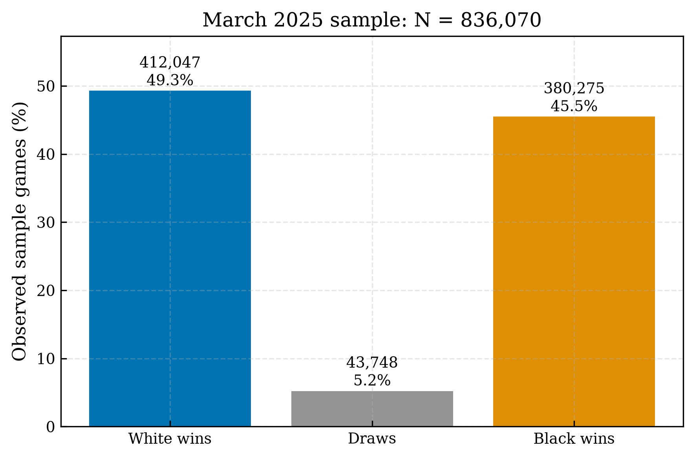

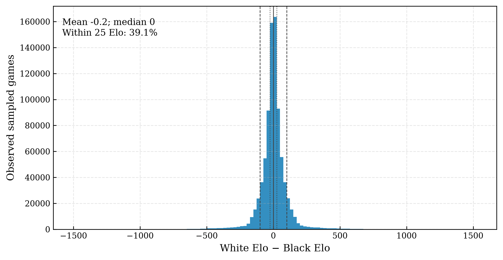

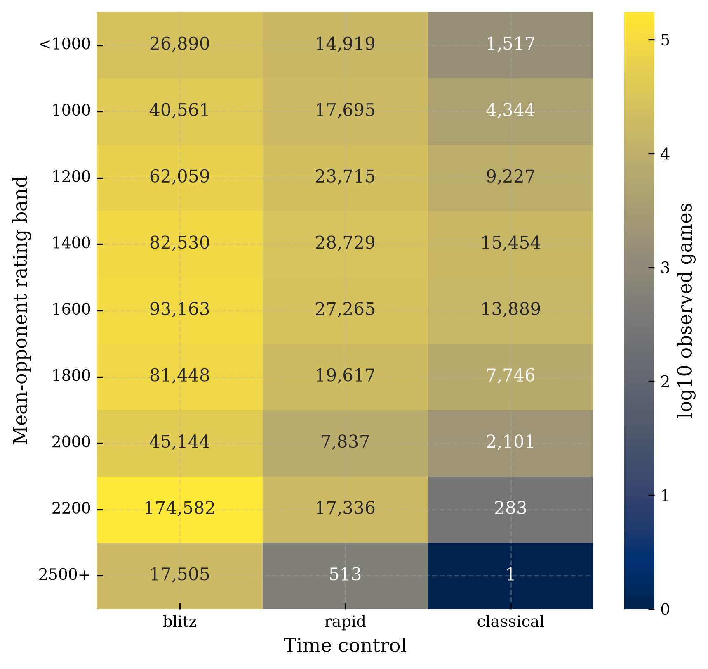

First-move, immediate-reply and PGN ECO/opening frequencies are exported in `results/`. These PGN labels are descriptions supplied by the source, not a newly validated Wikipedia classification.

## 4. Methodology

### Score and weights

For game i, Y_i is 1 for a White win, 0.5 for a draw, and 0 for a Black win. Unweighted S=(W+D/2)/N. Also report P(W)=W/N, P(D)=D/N, P(B)=B/N and P(W|decisive)=W/(W+B), with undefined empty/zero-decisive quantities represented as missing. Weighted score is:

\[\widehat S=\frac{\sum_i w_iY_i}{\sum_i w_i},\quad w_i=1/p_i.\]

Oversampling stronger/classical cells changes the raw mixture; inverse-probability weighting restores the estimated mixture of eligible source games. All precision calculations use observed counts.

### Bootstrap and H1 null

Seed **202503**, **10,000 replicates** throughout the final analyses. For weighted H1, compress counts by speed/band/outcome. Independent Poisson(count) multipliers are equivalent to Poisson(1) observation multipliers; rescale their centered deviations by sqrt(1-p) for the Bernoulli finite-population correction. Recalculate the weighted numerator **and denominator** per replicate. This represents stratum-mass uncertainty as well as outcome uncertainty under the independent pseudo-random-hash/Bernoulli sampling assumption. Report percentile 95% intervals and replicate SD. Unweighted sensitivity uses the analogous Poisson bootstrap without finite-population scaling. These are pointwise, not simultaneous intervals.

For each stratum, preserve its observed draw probability d and simulate Multinomial(n, ((1-d)/2, d, (1-d)/2)). Pool simulated scores using the original weights and observed stratum sizes. The one-sided Monte Carlo p is (1 + number of simulated scores at least observed)/(10000+1). Its resolution is **1/10001**: a value at that floor is not a zero p-value or a measurement of an extremely small exact probability. The null simulation treats sampled games as independent and is conservative with respect to the finite-population correction used in bootstrap intervals.

The [exact conditional binomial test](https://docs.scipy.org/doc/scipy/reference/generated/scipy.stats.binomtest.html) conditions on observed decisive games: W given W+B follows Binomial(W+B, 0.5) under color symmetry. It validates equal-weight/unweighted results, not the unequal-weight pooled test. Exact-test and simulated-null probabilities can differ slightly because one conditions on draws and one preserves their probability. The stratified simulation assumes color symmetry within every stratum, a stronger null than a pooled mean of 0.50 alone. A design-based Wald check uses sum((1-p_i)w_i²(Y_i-S)²)/(sum(w_i))² as its variance and tests the pooled mean directly; its one-sided p is 3.33e-183. It supports the same H1 decision without requiring stratum-by-stratum color symmetry.

Subgroups require n>=200 and at least 20 decisive games. The 38 eligible speed, band and speed-band tests form one secondary BH family; the prespecified primary test is excluded. The [Benjamini–Hochberg procedure](https://doi.org/10.1111/j.2517-6161.1995.tb02031.x) is used with its usual independence/positive-dependence assumptions. Repeated players and overlapping subgroup tests limit literal FDR guarantees. Marginal intervals are not multiplicity-adjusted.

### Rating and dependence adjustments

Near-equal means absolute Elo difference <=25; 10, 50 and 100 are sensitivity cutoffs. A weighted score mean regression uses speed-band intercepts and a natural cubic spline of rating difference (interior knots -200,-50,0,50,200). Standardize predictions to rating difference zero over the observed IPW speed-band mixture. This directly models the 0/0.5/1 mean; draws are not forced into a binary logistic outcome. 1 row in a cell below n=200 is omitted. The model is full rank (32/32), and 0 fitted predictions fall outside [0,1]. It remains a conditional-mean model with a shared rating curve and no player-skill fixed effects or causal identification.

Dyadic sandwich sensitivity permits covariance between games sharing a player in either color: covariance = sum over player totals of influence outer products, minus sum over unordered player-pair totals of influence outer products. The subtraction counts repeated-pair covariance once. Disjoint-player games are assumed independent. This follows the shared-member dependence structure of [Aronow, Samii and Assenova's dyadic variance estimator](https://arxiv.org/abs/1312.3398). We apply it to the primary score, the rating-adjusted standardized contrast, and two prespecified representative H2 cells; we do not claim that all H2 simulations have been clustered.

### H2

Every e4/d4 game enters exactly one first-move/speed/band/reply count. March uses **200 observed games/reply**, band >=1200, and >=2 eligible replies/cell. The Explorer floor remains 10,000. Thresholds were recorded before subgroup/reply outcomes were examined. Insufficient cells/replies remain flagged in exported tables; actual test coverage excludes cells with fewer than two replies.

Within each cell, under H0 simulate 10,000 independent multinomials at each reply's observed n using pooled W/D/B probabilities. The score statistic is the n-weighted SD across reply scores. Record observed range, null mean SD, and excess SD=sqrt(max(0, observed SD² − mean(null SD²))). Excess SD is a descriptive noise adjustment, not an unbiased effect estimator. The full-distribution statistic is Pearson's W/D/B statistic; its null calibration re-estimates the pooled mix in each simulated table. Separate BH families cover all 35 primary score-spread and full-distribution tests. Range p-values are supplementary, not a third confirmatory family.

Reply intervals use a 10,000-replicate multinomial bootstrap on independent observed games. Sparse/constant counts use conservative simultaneous exact binomial bounds for P(W) and P(B), transformed through S=(1+P(W)-P(B))/2. Individual replies are compared descriptively with the **remaining eligible replies**, which are disjoint. Their CIs are marginal and not valid as selection-adjusted intervals for the maximum/minimum. Highest/lowest White scores do not establish best/worst objective defenses.

## 5. Results — H1

**Reject H0 for the primary observed-population test.** White scores 51.776%, 95% CI 51.653%–51.899%, SE 0.0623 pp; the effect above 50% is 1.776 pp. One-sided MC p=9.999e-05 (simulation floor). IPW White win probability is 49.533%, draw probability 4.486%, Black win probability 45.980%, and decisive White win rate 51.860%. White's win probability and score are different quantities.

| Group                      |       N | White score   | 95% CI          |   Above 50% (pp) |   Adjusted p | Interpretation           |
|:---------------------------|--------:|:--------------|:----------------|-----------------:|-------------:|:-------------------------|
| Overall (primary weighted) | 836,070 | 51.776%       | 51.653%–51.899% |            1.776 |    9.999e-05 | Score above 50% detected |
| blitz                      | 623,882 | 51.776%       | 51.637%–51.915% |            1.776 |    0.0001267 | Score above 50% detected |
| classical                  |  54,562 | 51.793%       | 51.402%–52.182% |            1.793 |    0.0001267 | Score above 50% detected |
| rapid                      | 157,626 | 51.776%       | 51.523%–52.024% |            1.776 |    0.0001267 | Score above 50% detected |
| 0                          |  43,326 | 51.954%       | 51.483%–52.425% |            1.954 |    0.0001267 | Score above 50% detected |
| 1000                       |  62,600 | 52.067%       | 51.680%–52.466% |            2.067 |    0.0001267 | Score above 50% detected |
| 1200                       |  95,001 | 51.914%       | 51.588%–52.235% |            1.914 |    0.0001267 | Score above 50% detected |
| 1400                       | 126,713 | 51.795%       | 51.512%–52.080% |            1.795 |    0.0001267 | Score above 50% detected |
| 1600                       | 134,317 | 51.727%       | 51.451%–51.999% |            1.727 |    0.0001267 | Score above 50% detected |
| 1800                       | 108,811 | 51.370%       | 51.067%–51.666% |            1.37  |    0.0001267 | Score above 50% detected |
| 2000                       |  55,082 | 51.725%       | 51.322%–52.136% |            1.725 |    0.0001267 | Score above 50% detected |
| 2200                       | 192,201 | 52.336%       | 52.132%–52.539% |            2.336 |    0.0001267 | Score above 50% detected |
| 2500                       |  18,019 | 52.142%       | 51.481%–52.815% |            2.142 |    0.0001267 | Score above 50% detected |

All cells, including insufficient ones, are in `results/h1_results.csv`. The primary row's adjusted-p column repeats its unadjusted prespecified-test p. Raw sample score is 51.900% (95% CI 51.794%–52.005%), with exact conditional p=2.159e-279; this tiny exact p concerns the raw sample only. Sampling adjustment changes the score by -0.124 pp.

Near-equal games: n=327,230, weighted score **51.819%** (95% CI 51.637%–52.004%), MC p=9.999e-05. Rating-standardized score: **51.886%** (dyadic 95% CI 51.707%–52.064%; asymptotic one-sided p=3.951e-95). Dyadic sensitivity for the original weighted mean gives CI 51.655%–51.898%, p=1.069e-181. These secondary analyses support the direction of H1 while relying on their stated models.

Band-pooled scores range from 51.370% (band 1800) to 52.336% (band 2200). There is **no monotonic increase** across rating bands. Time-control estimates are blitz 51.776% (95% CI 51.637%–51.915%); classical 51.793% (95% CI 51.402%–52.182%); rapid 51.776% (95% CI 51.523%–52.024%). Their similar pooled point estimates do not prove equality; composition and within-band patterns differ, and this study does not claim a detected causal speed effect.

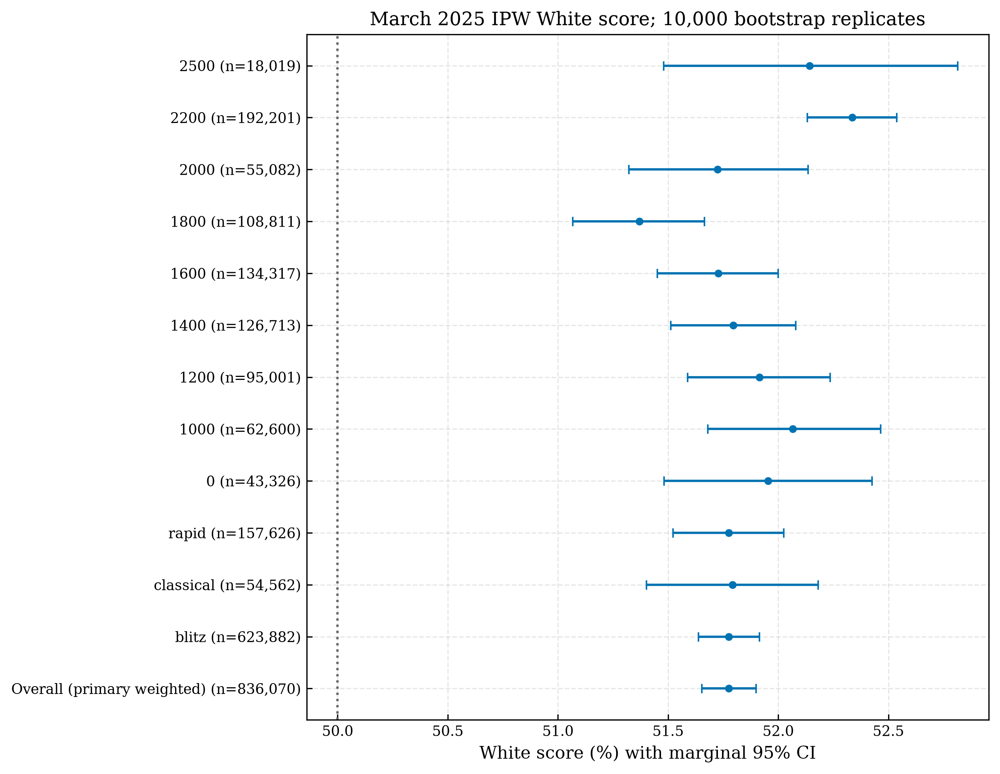

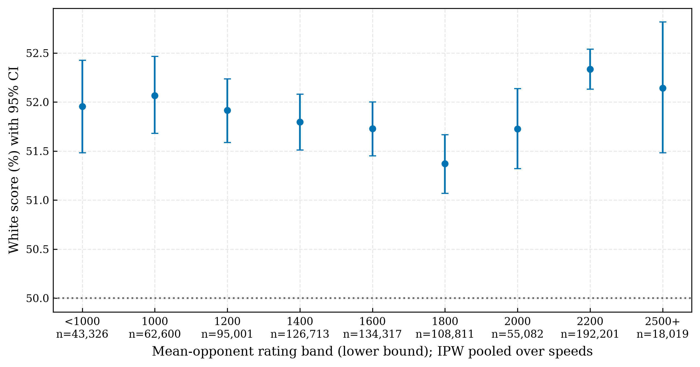

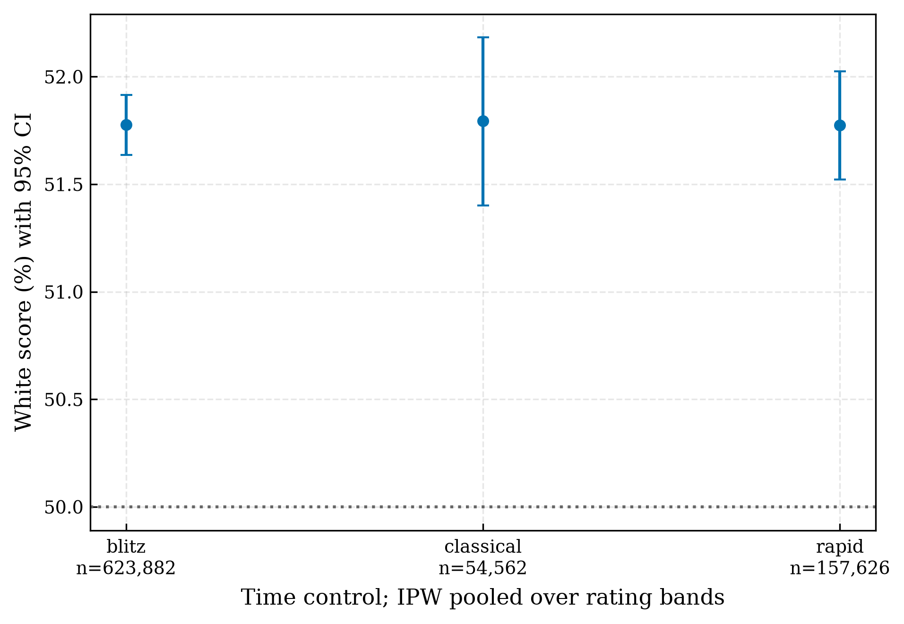

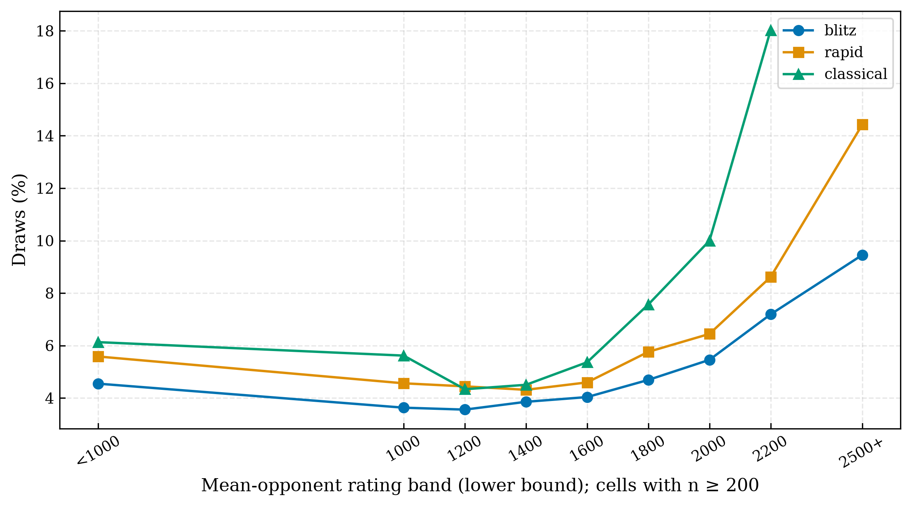

## 6. Results — H2

There are 714,224 e4/d4 games. Tested replies contribute 602,437 games: **84.35% of all e4/d4 games**, or **96.95% within the eligible rating bands**. Individual-cell coverage is in the table below. Eligible replies vary by cell. Across tested cells, e4 replies are Nc6, Nf6, a6, b6, c5, c6, d5, d6, e5, e6, g6; d4 replies are Nc6, Nf6, b6, c5, c6, d5, d6, e5, e6, f5, g6. Eligibility somewhere does not imply eligibility everywhere.

Score equality is rejected in **14/35 cells** after BH; full W/D/B equality in **15/35**. Thus H2 has evidence in some specified populations, not every rating/control group. Observed ranges span 1.09–12.30 pp (median 6.24); median excess SD is 1.20 pp. Extreme ranges are sensitive to sparse replies and selection; central spread is a more stable effect summary.

| First   | Speed     |   Band |   Included N |   Replies | Coverage   |   Range (pp) |   Excess SD (pp) |   q score |   q W/D/B | Highest White score   | Lowest White score   |
|:--------|:----------|-------:|-------------:|----------:|:-----------|-------------:|-----------------:|----------:|----------:|:----------------------|:---------------------|
| d4      | blitz     |   1200 |        13856 |        10 | 98.1%      |         7.18 |             1.8  | 0.005444  | 0.03069   | d5                    | f5                   |
| d4      | blitz     |   1400 |        19261 |        10 | 98.4%      |         4.82 |             0.96 | 0.1137    | 0.008749  | d5                    | c5                   |
| d4      | blitz     |   1600 |        23164 |        10 | 98.7%      |         6.24 |             1    | 0.06416   | 0.03375   | e6                    | c5                   |
| d4      | blitz     |   1800 |        21856 |        10 | 98.6%      |         3.64 |             0.6  | 0.2951    | 0.7327    | e5                    | c5                   |
| d4      | blitz     |   2000 |        13051 |         9 | 97.3%      |         5.27 |             1.1  | 0.1138    | 0.0497    | e6                    | c5                   |
| d4      | blitz     |   2200 |        56097 |        11 | 99.3%      |         5.02 |             0.24 | 0.4151    | 0.001312  | b6                    | d6                   |
| d4      | blitz     |   2500 |         5188 |         4 | 88.9%      |         2.97 |             0    | 0.7587    | 0.3252    | e6                    | d5                   |
| d4      | classical |   1400 |         2480 |         3 | 78.1%      |         7.62 |             2.49 | 0.0335    | 0.06539   | d5                    | Nf6                  |
| d4      | classical |   1600 |         2611 |         3 | 80.7%      |         8.49 |             3.13 | 0.007349  | 0.03069   | d5                    | e6                   |
| d4      | classical |   1800 |         1522 |         2 | 75.7%      |         2.86 |             0.66 | 0.3466    | 0.5955    | d5                    | Nf6                  |
| d4      | classical |   2000 |          557 |         2 | 82.0%      |         4.71 |             1.2  | 0.3372    | 0.09599   | d5                    | Nf6                  |
| d4      | rapid     |   1200 |         4202 |         4 | 83.1%      |        10.08 |             2.19 | 0.03069   | 0.06539   | e6                    | e5                   |
| d4      | rapid     |   1400 |         5782 |         6 | 89.9%      |         6.06 |             1.3  | 0.1701    | 0.25      | c6                    | Nf6                  |
| d4      | rapid     |   1600 |         5936 |         6 | 89.4%      |         6.91 |             2.04 | 0.02916   | 0.06539   | c6                    | Nf6                  |
| d4      | rapid     |   1800 |         4319 |         5 | 86.0%      |         8.13 |             1.52 | 0.1362    | 0.1638    | d5                    | g6                   |
| d4      | rapid     |   2000 |         1565 |         2 | 72.6%      |         1.52 |             0    | 0.585     | 0.8254    | d5                    | Nf6                  |
| d4      | rapid     |   2200 |         4497 |         3 | 85.7%      |         7.4  |             1.29 | 0.1171    | 0.1199    | e6                    | d5                   |
| e4      | blitz     |   1200 |        39968 |        10 | 98.9%      |         6.6  |             1.68 | 0.0006999 | 0.0005833 | b6                    | c5                   |
| e4      | blitz     |   1400 |        51866 |        10 | 99.0%      |         4.81 |             1.58 | 0.0006999 | 0.0005833 | e5                    | c6                   |
| e4      | blitz     |   1600 |        56509 |        10 | 99.2%      |         6.24 |             1.45 | 0.0006999 | 0.0005833 | b6                    | Nf6                  |
| e4      | blitz     |   1800 |        46809 |        10 | 99.1%      |         4.53 |             0.82 | 0.02291   | 0.08942   | b6                    | Nf6                  |
| e4      | blitz     |   2000 |        23926 |        10 | 99.4%      |         5.78 |             0    | 0.5725    | 0.8254    | b6                    | Nf6                  |
| e4      | blitz     |   2200 |        83675 |        11 | 99.6%      |         2.87 |             0.32 | 0.2813    | 0.008749  | a6                    | g6                   |
| e4      | blitz     |   2500 |         7659 |         8 | 97.2%      |         7.01 |             0.56 | 0.4151    | 0.6231    | d5                    | g6                   |
| e4      | classical |   1200 |         5690 |         5 | 90.2%      |         9.34 |             2.41 | 0.0035    | 0.03069   | e5                    | c6                   |
| e4      | classical |   1400 |         9627 |         6 | 93.2%      |        12.3  |             3.58 | 0.0006999 | 0.0005833 | d5                    | c5                   |
| e4      | classical |   1600 |         8452 |         6 | 94.2%      |         6.69 |             2.4  | 0.001167  | 0.0009999 | e5                    | e6                   |
| e4      | classical |   1800 |         4393 |         6 | 93.8%      |         3.51 |             0    | 0.7804    | 0.7416    | d6                    | c5                   |
| e4      | classical |   2000 |          642 |         2 | 57.4%      |         1.09 |             0    | 0.7804    | 0.5955    | e5                    | c5                   |
| e4      | rapid     |   1200 |        15959 |         9 | 97.9%      |         8.65 |             1.16 | 0.06715   | 0.1611    | Nc6                   | c5                   |
| e4      | rapid     |   1400 |        19054 |         9 | 98.3%      |         7.71 |             2.17 | 0.0006999 | 0.0005833 | Nc6                   | c6                   |
| e4      | rapid     |   1600 |        17210 |         8 | 97.2%      |         6.37 |             1.68 | 0.0015    | 0.0005833 | e5                    | g6                   |
| e4      | rapid     |   1800 |        11929 |         8 | 96.6%      |         5.26 |             0.19 | 0.4826    | 0.2079    | g6                    | e6                   |
| e4      | rapid     |   2000 |         4366 |         6 | 92.8%      |         5.38 |             0.14 | 0.4826    | 0.5867    | d5                    | d6                   |
| e4      | rapid     |   2200 |         8759 |         6 | 93.4%      |         7.23 |             1.36 | 0.06855   | 0.06539   | d6                    | c5                   |

For the prespecified e4/blitz/1600 cell, n=56,509, 10 replies, coverage 99.2%, observed SD 1.578 pp, null mean SD 0.600 pp, excess SD 1.452 pp and range 6.243 pp. Score q=0.0006999; full-distribution q=0.0005833. The highest observed White score is after b6: 53.804% (CI 51.182%–56.352%, n=1,354); the lowest after Nf6: 47.561% (CI 43.970%–51.084%, n=738). These are selected descriptive extremes. Dyadic score-equality sensitivity p=2.727e-09 is exploratory.

The d4/blitz/1600 score-spread q=0.06416 does not pass .05, while its full-distribution q=0.03375 does. Its exploratory dyadic score Wald p=0.02395 is not BH-adjusted and does not override the primary score decision. Different score and distribution decisions illustrate why both statistics are needed.

Representative reply-level details (blitz, mean Elo 1600–1799):

| First   | Reply   |     N | White score   | 95% CI          |   Reply − remaining replies (pp) | Contrast 95% CI (pp)   |
|:--------|:--------|------:|:--------------|:----------------|---------------------------------:|:-----------------------|
| d4      | Nf6     |  4142 | 52.233%       | 50.736%–53.718% |                            -0.3  | -1.94–1.34             |
| d4      | b6      |   551 | 48.276%       | 44.192%–52.359% |                            -4.31 | -8.44–-0.17            |
| d4      | c5      |   830 | 48.253%       | 44.940%–51.506% |                            -4.38 | -7.76–-1.01            |
| d4      | c6      |   958 | 52.557%       | 49.478%–55.637% |                             0.08 | -3.06–3.22             |
| d4      | d5      | 10356 | 53.071%       | 52.149%–54.007% |                             1.07 | -0.19–2.33             |
| d4      | d6      |   774 | 49.871%       | 46.447%–53.295% |                            -2.7  | -6.22–0.82             |
| d4      | e5      |  1528 | 51.603%       | 49.182%–54.090% |                            -0.94 | -3.48–1.60             |
| d4      | e6      |  2325 | 54.495%       | 52.516%–56.430% |                             2.24 | 0.16–4.32              |
| d4      | f5      |   504 | 52.679%       | 48.413%–56.944% |                             0.2  | -4.14–4.54             |
| d4      | g6      |  1196 | 51.839%       | 49.080%–54.600% |                            -0.68 | -3.55–2.19             |
| e4      | Nc6     |   780 | 53.013%       | 49.615%–56.474% |                             1.73 | -1.72–5.17             |
| e4      | Nf6     |   738 | 47.561%       | 43.970%–51.084% |                            -3.8  | -7.35–-0.25            |
| e4      | b6      |  1354 | 53.804%       | 51.182%–56.352% |                             2.55 | -0.07–5.18             |
| e4      | c5      | 10514 | 49.543%       | 48.616%–50.476% |                            -2.17 | -3.20–-1.14            |
| e4      | c6      |  5087 | 50.187%       | 48.860%–51.533% |                            -1.24 | -2.64–0.17             |
| e4      | d5      |  6116 | 50.253%       | 49.060%–51.488% |                            -1.19 | -2.48–0.11             |
| e4      | d6      |  2137 | 50.398%       | 48.339%–52.504% |                            -0.95 | -3.07–1.17             |
| e4      | e5      | 21668 | 52.991%       | 52.344%–53.634% |                             2.72 | 1.90–3.55              |
| e4      | e6      |  6094 | 50.098%       | 48.868%–51.337% |                            -1.36 | -2.67–-0.05            |
| e4      | g6      |  2021 | 52.202%       | 50.099%–54.330% |                             0.92 | -1.24–3.09             |

All reply scores and exclusion flags are in `results/h2_reply_scores.csv`. Do not treat these selected contrasts as a confirmatory pairwise testing family.

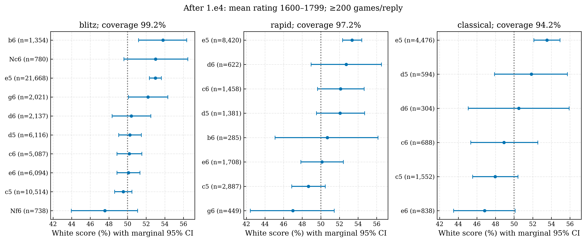

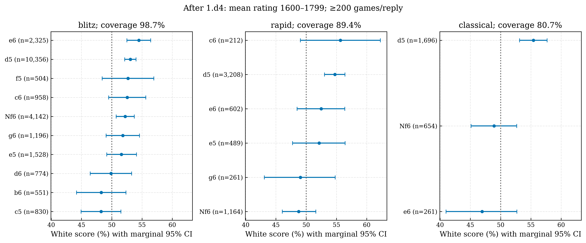

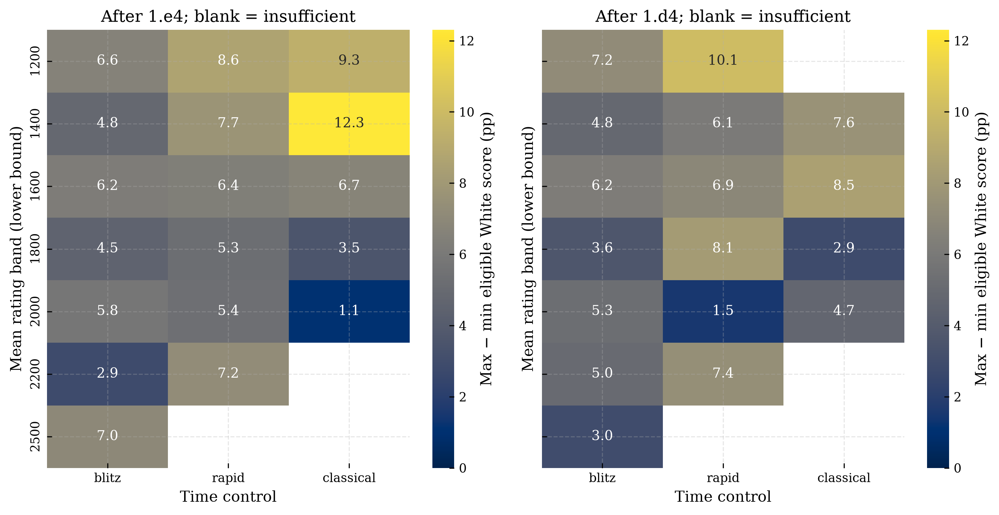

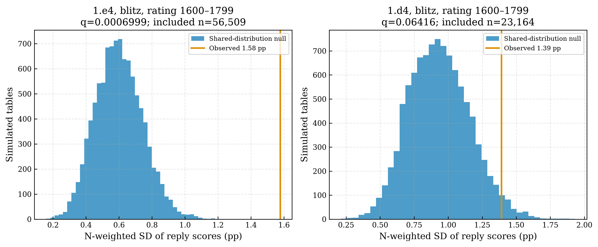

## 7. Discussion and robustness

A 1.78 pp excess score is small for an individual game but meaningful as a population-level scoring imbalance. The small p-value measures incompatibility with a symmetry null under the model, not a large practical effect or proof of mechanism. Near-equal-rating and equal-rating model results indicate that measured rating imbalance alone does not remove H1.

The alternatives below are sensitivity analyses, not revisions to the primary sample. Their p-values are exploratory, unadjusted Monte Carlo values. A 1 pp change is a transparent material-change flag, not a universal chess importance threshold.

| Sensitivity                       |      N | Score   | 95% CI          |   Change from primary (pp) |   One-sided MC p | Material change ≥1 pp   |
|:----------------------------------|-------:|:--------|:----------------|---------------------------:|-----------------:|:------------------------|
| Unweighted sample                 | 836070 | 51.900% | 51.794%–52.005% |                      0.124 |        9.999e-05 | False                   |
| Absolute rating difference <= 10  | 158880 | 51.735% | 51.475%–51.996% |                     -0.041 |        9.999e-05 | False                   |
| Absolute rating difference <= 25  | 327230 | 51.819% | 51.637%–52.004% |                      0.042 |        9.999e-05 | False                   |
| Absolute rating difference <= 50  | 509899 | 51.882% | 51.730%–52.030% |                      0.105 |        9.999e-05 | False                   |
| Absolute rating difference <= 100 | 690892 | 51.851% | 51.720%–51.980% |                      0.075 |        9.999e-05 | False                   |
| Exclude time forfeits             | 665036 | 52.149% | 52.013%–52.284% |                      0.373 |        9.999e-05 | False                   |
| At least 10 plies                 | 827981 | 51.700% | 51.578%–51.822% |                     -0.076 |        9.999e-05 | False                   |
| At least 40 plies                 | 688011 | 50.769% | 50.637%–50.903% |                     -1.007 |        9.999e-05 | True                    |
| Bands >=1200                      | 730144 | 51.727% | 51.593%–51.858% |                     -0.049 |        9.999e-05 | False                   |
| Bands <2200                       | 625850 | 51.757% | 51.633%–51.881% |                     -0.02  |        9.999e-05 | False                   |
| Exclude classical                 | 781508 | 51.776% | 51.655%–51.899% |                     -0     |        9.999e-05 | False                   |

Every H1 sensitivity remains positive and detectable in this analysis. The 40-ply restriction reduces the score to 50.769% (95% CI 50.637%–50.903%), a -1.007 pp change. It removes legitimate short outcomes and conditions on a post-opening variable; it targets a different population and demonstrates sensitivity in magnitude, not a reason to discard short games. Forfeit exclusion also changes the mix. These results support the direction more strongly than a universal effect size.

| Sensitivity           |   Cells |   Score rejections |   W/D/B rejections |   Median range (pp) | Any matched decision change   |
|:----------------------|--------:|-------------------:|-------------------:|--------------------:|:------------------------------|
| Reply floor 100       |      36 |                 11 |                 12 |                7.26 | True                          |
| Reply floor 500       |      32 |                 11 |                 14 |                4.25 | True                          |
| Reply floor 1000      |      26 |                 13 |                 15 |                3.11 | True                          |
| All rating bands      |      44 |                 15 |                 14 |                6.24 | False                         |
| Near equal <=25       |      28 |                  1 |                  0 |                5.34 | True                          |
| Exclude time forfeits |      35 |                 22 |                 18 |                6.6  | True                          |
| At least 10 plies     |      35 |                 13 |                 13 |                6.15 | True                          |

H2 cell decisions and selected extremes change with reply thresholds; `results/h2_sensitivity_cells.csv` records matched-cell range changes, decision changes and extreme-reply changes. Near-equal ratings leave only **1/28 score rejections**. Both reduced sample size/coverage and confounding can explain this attenuation; the analysis cannot apportion them. A claim of a stable causal defense ranking is unsupported. The all-band sensitivity evaluates the existing lower-band restriction; within-cell weighting is constant and therefore cannot change H2. Speed subsets simply retain their corresponding cells rather than adding overlapping tests.

## 8. Limitations

- This is one site's rated-standard game population, one month, selected controls and recorded filters. It does not establish full-year, over-the-board or Masters outcomes.
- Hash sampling is treated as pseudo-random Bernoulli selection; population stratum totals are estimated. Bootstrap uncertainty depends on that design approximation and the observed-game outcome/dependence assumptions.
- Elo measurements have error and do not identify latent player strength. The mean-rating bands can contain uneven matches. The regression shares a spline across bands/speeds; it does not establish exchangeability or causal identification.
- Repeated players create dependence. Dyadic sensitivity permits shared-player covariance but assumes independent disjoint-player games and does not repair all possible temporal, tournament or network dependence. Most H2 tests remain independent-game simulations; BH guarantees are conditional on standard dependence assumptions.
- High-rating classical data are sparse (only one game in the 2500+ classical cell). Sparse groups are inconclusive, not evidence of equality.
- Reply selection is endogenous; different players choose different defenses. Marginal reply intervals and extreme ranks are not simultaneous or selection-adjusted. H2 weakens substantially after equal-rating restriction.
- Game-length and forfeit sensitivities change the target population. The 40-ply restriction materially reduces H1 magnitude.
- The archived Explorer aggregates have no authenticatable date configuration or cached responses. A current collector default cannot retroactively prove the period. No aligned numeric comparison is made; `source_comparison.csv` explicitly records unavailability. No API token is available in this environment. Original archive data are preserved.
- Explorer rating-bucket alignment with mean-Elo sample bands remains unverified. The [official query implementation](https://github.com/lichess-org/lila-openingexplorer/blob/master/src/api/query.rs) supports explicit month filters, but that alone does not authenticate historical collection or selection equivalence.
- No validated full ECO mapping is present. PGN opening labels are descriptive. Immediate Black replies require no ECO join; this limitation does not prevent H2.

## 9. Conclusion

In the eligible March 2025 Lichess population, White has an observed weighted score of **51.776% (95% CI 51.653%–51.899%)**, **1.776 pp above 50%**, with one-sided MC p=9.999e-05. H1 is statistically supported and remains supported by near-equal-rating and rating-standardized analyses (51.819% and 51.886%). Effects vary across rating categories without a monotonic trend; pooled speed scores are similar.

H2 finds score-distribution associations in some cells: **14/35 score-spread and 15/35 full-outcome tests** pass their separate BH corrections. The median observed range is 6.24 pp, with a median noise-adjusted SD of 1.20 pp. Equal-rating restriction substantially weakens score evidence. These data demonstrate observational associations and conditional uncertainty, not that the first move or a named defense causes a specified change in outcomes.

## 10. Reproducibility

From the repository root:

```bash
python -m venv .venv
source .venv/bin/activate
python -m pip install -r requirements.txt
python -m src.run_analysis
python -m jupyter nbconvert --to notebook --execute --inplace analysis.ipynb --ExecutePreprocessor.timeout=600
python -m pytest -q
python tests/mock_run.py
```

No routine step downloads games or calls Explorer/Wikipedia. The notebook reruns the same offline pipeline and renders these exported results. Generated artifacts: `results/dataset_summary.json`, `h1_results.csv`, `h1_summary.json`, `h2_results.csv`, `h2_reply_scores.csv`, `h2_summary.json`, `robustness_results.csv`, `h2_sensitivity_cells.csv`, `source_comparison.csv`, EDA/frequency tables, model coefficients and `software_versions.json`. Source code provides every calculation. Figures 1–10 plus `h1_score_confidence_intervals` are exported as 300-dpi PNG and PDF. Legacy exploratory figures retain their names and are not evidence for this report.

The frozen seed is 202503; final simulation count is 10,000. Dependency versions from the executed environment are in `results/software_versions.json`. The manifest hashes the source data; automated tests cover known score identities, invalid data, provenance tampering, null calibration, planted effects, weighting imbalance, sparse replies, full-distribution changes, dyadic covariance and artifact consistency. Verification results are recorded separately in `reports/COMPLETION_CHECKLIST.md` so regeneration does not invent test outcomes.

Optional future collection: stream each additional monthly dump with the same documented filters and ID rule, save/validate a separate manifest and checksum, then combine months with weights and month-aware sensitivity checks. Do not relabel March as a full year. For optional Explorer validation, explicitly query March 2025 (or a separately labeled full year), save full query/response sidecars and checksums, validate nested counts, and resolve rating/filter equivalence before numeric comparison. No such collection is required for the scoped March result.
